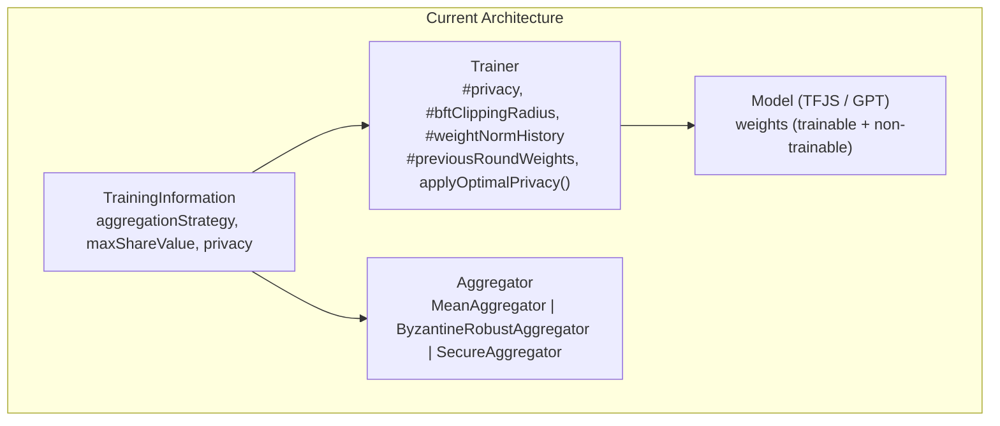
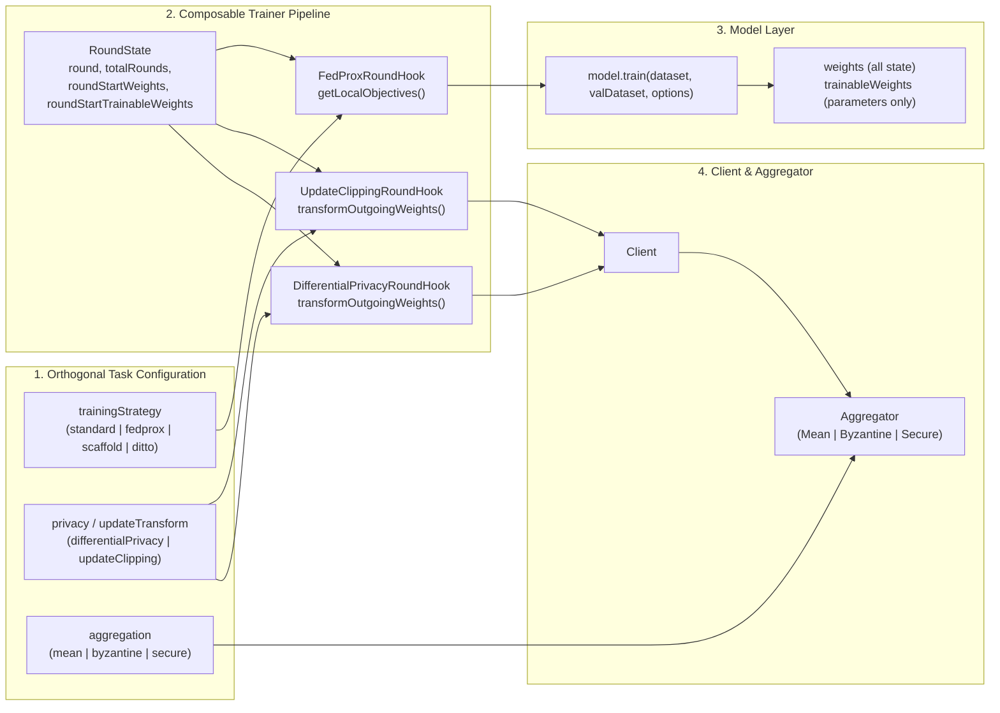
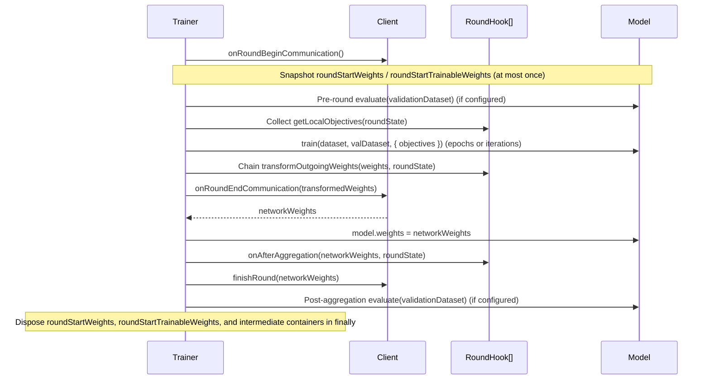

# Collaborative Training Architecture Design Document

## 1. Overview & Motivation

Disco supports collaborative machine learning across local, federated, and decentralized topologies. As the framework grows beyond standard Federated Averaging (FedAvg) to support richer optimization, robustness, and privacy algorithms—such as **FedProx**, **SCAFFOLD**, **FedNova**, **Ditto** (personalized federated learning), **FedOpt** (server-side adaptive optimizers), **Differential Privacy (ALDP-FL)**, **Byzantine-robust aggregation (Centered Clipping)**, and **Secure Aggregation (MPC)**—the current abstractions in `discojs` exhibit structural coupling that makes adding and composing algorithms difficult.

This design document analyzes the current architectural limitations in `discojs` and proposes a modular, composable target architecture that separates **local client optimization**, **post-round update transformations**, and **inter-client weight aggregation**.

---

## 2. Problem Statement: Current Architectural Limitations



### 2.1. Conflation of Orthogonal Algorithmic Axes

In collaborative and federated learning, a training algorithm is defined along **three orthogonal axes**:

1. **Intra-Round Local Training Strategy (Client Optimization):** How each client optimizes its local model over its local dataset during a round:
   - Standard Empirical Risk Minimization (FedAvg)
   - Proximal regularization towards the round's initial weights: $\min_w F_k(w) + \frac{\mu}{2}\|w - w^{(t)}\|^2$ (FedProx)
   - Control-variate gradient correction: $g \leftarrow g - c_i + c$ (SCAFFOLD)
   - Personalized local regularization against the global model (Ditto)
2. **Post-Round Client Update Transformation & Privacy (Pre-Communication):** How a client transforms its local weight progress $\Delta w_i^{(t)} = w_i^{(t, K)} - w^{(t)}$ after completing local epochs/iterations and before transmitting weights to the server or peers:
   - Adaptive layer-wise Frobenius norm clipping + Gaussian noise injection (ALDP-FL Differential Privacy)
   - Explicit global or per-layer update norm clipping
   - Local step-count normalization $\Delta w_i^{(t)} / \tau_i$ (FedNova)
   - Update quantization or sparsification
3. **Inter-Client Weight Aggregation & Protocol (Server / Peer Combination):** How updates from multiple participants are combined across the network:
   - Unweighted or sample-weighted arithmetic mean (`MeanAggregator`)
   - Iterative Centered Clipping with momentum (`ByzantineRobustAggregator`)
   - Multi-round additive secret sharing (`SecureAggregator`)
   - Server-side adaptive optimization (`FedOpt` / Server Adam / Yogi)

Currently, `TrainingInformation` models algorithm selection through a single `aggregationStrategy` field coupled with disjoint parameters (`privacy.byzantineFaultTolerance`, `privacy.differentialPrivacy`, and root-level `maxShareValue`). Under this structure:

- Client-side local training strategies (such as FedProx) have no dedicated configuration axis. Modeling them as an `aggregationStrategy` forces the aggregator factory (`getAggregator`) to map a client-side optimizer to `MeanAggregator`, and **makes it impossible to combine FedProx with Byzantine-robust aggregation or Secure Aggregation**.
- Adding any new algorithm requires modifying the `aggregationStrategy` union, the task schemas, the CLI parser, and the webapp form in lockstep.

### 2.2. Responsibility Leak Between `ByzantineRobustAggregator` and `Trainer`

In `discojs/src/training/trainer.ts` and `discojs/src/privacy.ts`, `ByzantineRobustAggregator`'s configuration leaks directly into client-side execution inside `Trainer`:

1. **Duplicated and misplaced clipping responsibility:** `ByzantineRobustAggregator` (`discojs/src/aggregator/byzantine.ts`) performs Centered Clipping on the receiving server or peer—which is where Byzantine fault tolerance must be enforced, because malicious peers do not obey client-side clipping. However, `Trainer` also extracts `byzantineFaultTolerance.clippingRadius` and calls `applyOptimalPrivacy` at the end of every client round to pre-clip outgoing weights even when Differential Privacy is disabled.
2. **Mathematical norm mismatch:** `ByzantineRobustAggregator` computes and clips by the **global Euclidean ($L_2$) norm** across all weight tensors:
   $$\text{norm}(\Delta w) = \sqrt{\sum_{l=1}^{L} \|\Delta w_l\|_F^2}$$
   Conversely, `Trainer` passes `Repeat(bftClippingRadius).take(numLayers)` into `privacy.clipNorm` (`discojs/src/privacy.ts`), which clips **each layer's Frobenius norm individually** to `bftClippingRadius`.
3. **Conflated `applyOptimalPrivacy` helper:** `applyOptimalPrivacy` in `discojs/src/training/trainer.ts` is invoked even when Differential Privacy is disabled, coupling ALDP-FL adaptive noise calibration with unconditional client update clipping.

### 2.3. Monolithic `Trainer` State and Duplicated Round Lifecycle

`Trainer` (`discojs/src/training/trainer.ts`) violates the Open-Closed Principle by accumulating private fields and lifecycle branches for each feature:

- `#privacy`, `#bftClippingRadius`, `#weightNormHistory`, and `#previousRoundWeights` are hardcoded directly on `Trainer`.
- Every new client-side algorithm (e.g., FedProx, SCAFFOLD control variates, FedNova step counters) forces additional private fields, constructor checks, and round-boundary branches into `Trainer`.
- **Duplicated round loops:** `#runRoundsByEpoch` / `#runRoundByEpoch` and `#runRoundsByIteration` / `#runRoundByIteration` duplicate round-begin communication, `#previousRoundWeights` tensor cloning, pre-aggregation validation, and `#finishRoundCommunication` invocation.

### 2.4. `Model` Contract Limitations and Trainable vs. Non-Trainable Weights

The `Model<D>` abstraction (`discojs/src/models/model.ts`) and its implementations (`TFJS` in `discojs/src/models/tfjs.ts` and `GPT` in `discojs/src/models/implementations/gpt/gpt.ts`) have three architectural gaps when supporting custom local training algorithms:

1. **`Model.weights` mixes trainable parameters with non-trainable state:**
   In TensorFlow.js (`tf.LayersModel`), `this.model.weights` includes both `trainableWeights` (kernels, biases) and `nonTrainableWeights` (such as `BatchNormalization`'s `moving_mean` and `moving_variance`). While serialization and aggregation need all `weights`, local objective regularizers (such as FedProx's $\frac{\mu}{2}\|w - w^{(t)}\|^2$) must operate strictly on **trainable parameters**. Computing proximal penalties over `Model.weights` during training mode (`{ training: true }`) includes running-statistic drift in the scalar loss and performs unnecessary tensor operations on non-trainable buffers every batch.
2. **No backend-agnostic contract for local training modifications:**
   `Model.train(trainingDataset, validationDataset)` has no declarative way to receive intra-round training modifiers (such as proximal anchor weights or gradient correction terms) without leaking `@tensorflow/tfjs` types into `model.ts`.
3. **Divergent custom training loops across model backends:**
   - Standard `TFJS` training delegates to `this.model.fit(xs, ys)`.
   - Custom regularized training in `TFJS` requires a custom `optimizer.minimize` loop that must faithfully replicate `tf.LayersModel`'s training behavior (`{ training: true }` forward pass for `Dropout`/`BatchNormalization`, `this.model.calculateLosses()` for layer regularizers, `this.model.trainableWeights` variable filtering, and compiled loss/metric resolution).
   - Iteration-based training for `GPT` relies on an unsafe cast (`this.model as unknown as IterationTrainableTextModel`) in `Trainer` instead of a typed method on `Model`.

### 2.5. Schema & Strategy Duplication Across Packages

Strategy identifiers and parameter schemas are currently repeated across:

- `discojs/src/task/training_information.ts` (`networkToSchema.decentralized`, `networkToSchema.federated`, `networkToSchema.local`)
- `cli/src/args.ts` (CLI strategy set, parameter parsing, and scheme validation `switch` statements)
- `webapp/src/components/task_creation_form/TaskCreationForm.vue` (re-declared `nonLocalNetworkSchema`, `trainingInformationNetworks`, and `<option>` lists)

---

## 3. Proposed Target Architecture



### 3.1. Three-Axis Task Configuration Schema (`discojs/src/task/training_information.ts`)

Decouple `aggregation` (how participants combine weights), `trainingStrategy` (how each client optimizes locally during a round), and `privacy` / update transforms (how a client post-processes its round update before communication):

```ts
import { z } from "zod";

// ---------------------------------------------------------------------------
// Axis 1: Inter-Client Aggregation Configuration (Server / Peer-to-Peer)
// ---------------------------------------------------------------------------
export const meanAggregationConfigSchema = z.object({
  aggregationStrategy: z.literal("mean"),
  aggregationParams: z.undefined().optional(),
});

export const byzantineAggregationConfigSchema = z.object({
  aggregationStrategy: z.literal("byzantine"),
  aggregationParams: z
    .strictObject({
      clippingRadius: z.number().positive().default(1.0),
      maxIterations: z.number().int().positive().default(1),
      beta: z.number().min(0).max(1).default(0.9),
    })
    .default({ clippingRadius: 1.0, maxIterations: 1, beta: 0.9 }),
});

export const secureAggregationConfigSchema = z.object({
  aggregationStrategy: z.literal("secure"),
  aggregationParams: z
    .strictObject({
      maxShareValue: z.number().positive().int().default(100),
    })
    .default({ maxShareValue: 100 }),
});

export const federatedAggregationConfigSchema = z.discriminatedUnion(
  "aggregationStrategy",
  [meanAggregationConfigSchema, byzantineAggregationConfigSchema],
);

export const decentralizedAggregationConfigSchema = z.discriminatedUnion(
  "aggregationStrategy",
  [
    meanAggregationConfigSchema,
    byzantineAggregationConfigSchema,
    secureAggregationConfigSchema,
  ],
);

export type AggregationConfig = z.infer<
  typeof decentralizedAggregationConfigSchema
>;
export type AggregationStrategy = AggregationConfig["aggregationStrategy"];

// ---------------------------------------------------------------------------
// Axis 2: Intra-Round Local Training Strategy (Client Optimization)
// Composable with ANY AggregationConfig!
// ---------------------------------------------------------------------------
export const trainingStrategySchema = z
  .discriminatedUnion("strategy", [
    z.strictObject({
      strategy: z.literal("standard"),
    }),
    z.strictObject({
      strategy: z.literal("fedprox"),
      mu: z.number().positive().default(0.01),
    }),
    // Future extensions:
    // z.strictObject({
    //   strategy: z.literal("ditto"),
    //   lambda: z.number().positive().default(0.1),
    // }),
    // z.strictObject({
    //   strategy: z.literal("scaffold"),
    // }),
  ])
  .default({ strategy: "standard" });

export type TrainingStrategyConfig = z.infer<typeof trainingStrategySchema>;

// ---------------------------------------------------------------------------
// Axis 3: Post-Round Client Update Transforms & Privacy
// ---------------------------------------------------------------------------
export const privacySchema = z.object({
  differentialPrivacy: z
    .strictObject({
      clippingRadius: z.number().positive().default(1),
      epsilon: z.number().positive(),
      delta: z.number().gt(0).lt(1),
    })
    .optional(),
  updateClipping: z
    .strictObject({
      clippingRadius: z.number().positive(),
      scope: z.enum(["global", "per-layer"]).default("global"),
    })
    .optional(),
});
```

#### Key Benefits of this Schema Design:

1. **Full composability:** A task can pair `trainingStrategy: { strategy: "fedprox", mu: 0.01 }` with `aggregationStrategy: "byzantine"` or `aggregationStrategy: "secure"`, and with `privacy.differentialPrivacy`.
2. **Single source of truth per network scheme:** `federatedAggregationConfigSchema` and `decentralizedAggregationConfigSchema` are exported directly from `discojs` and reused in `webapp` and `cli` without repeating `z.literal([...])` or `z.enum([...])` lists.
3. **Clean separation of client vs. aggregator clipping:** `byzantine.aggregationParams.clippingRadius` configures `ByzantineRobustAggregator`'s Centered Clipping exclusively, while client-side update clipping is explicitly configured via `privacy.updateClipping` (or `privacy.differentialPrivacy`).

---

### 3.2. Composable `RoundHook` Pipeline in `Trainer`

Instead of hardcoding algorithm-specific fields (`#privacy`, `#bftClippingRadius`, `#weightNormHistory`, `#previousRoundWeights`) in `Trainer`, `Trainer` orchestrates an ordered list of `RoundHook` instances created from `Task.trainingInformation`.

```ts
import type { WeightsContainer } from "#weights/index";
import type { LocalObjectiveTerm } from "#models/index";

/**
 * Immutable snapshot of the round state managed by Trainer.
 * Snapshots are cloned at most ONCE per round if requested by any active hook,
 * and disposed automatically by Trainer at the end of the round.
 */
export interface RoundState {
  readonly round: number;
  readonly totalRounds: number;
  readonly roundStartWeights?: WeightsContainer;
  readonly roundStartTrainableWeights?: WeightsContainer;
}

/**
 * Modular lifecycle hook for client-side collaborative learning algorithms.
 */
export interface RoundHook extends Partial<Disposable> {
  /** If true, Trainer snapshots `model.weights.clone()` once at the start of each round. */
  readonly requiresRoundStartWeights?: boolean;

  /** If true, Trainer snapshots `model.trainableWeights.clone()` once at the start of each round. */
  readonly requiresRoundStartTrainableWeights?: boolean;

  /**
   * Returns local objective terms (e.g., FedProx proximal regularization)
   * passed to `model.train()` during this round.
   */
  getLocalObjectives?(state: RoundState): readonly LocalObjectiveTerm[];

  /**
   * Transforms outgoing model weights at the end of local training before
   * `client.onRoundEndCommunication()` sends them to the server or peers.
   */
  transformOutgoingWeights?(
    currentWeights: WeightsContainer,
    state: RoundState,
  ): Promise<WeightsContainer> | WeightsContainer;

  /**
   * Invoked after `client.onRoundEndCommunication()` returns the aggregated weights.
   * Enables stateful post-aggregation updates (e.g., SCAFFOLD control variates, Ditto personalization).
   */
  onAfterAggregation?(
    aggregatedWeights: WeightsContainer,
    state: RoundState,
  ): Promise<void> | void;
}
```

#### How Existing & Future Algorithms Map to `RoundHook`:

| Algorithm                          | Hook Implementation            | Lifecycle Methods Used                                                                                                                                                                        |
| :--------------------------------- | :----------------------------- | :-------------------------------------------------------------------------------------------------------------------------------------------------------------------------------------------- |
| **FedProx**                        | `FedProxRoundHook`             | `requiresRoundStartTrainableWeights = true`<br/>`getLocalObjectives(state)` $\rightarrow$ `[{ type: "proximal", anchorWeights: state.roundStartTrainableWeights, mu }]`                       |
| **Differential Privacy (ALDP-FL)** | `DifferentialPrivacyRoundHook` | `requiresRoundStartWeights = true`<br/>Privately owns `#weightNormHistory`.<br/>`transformOutgoingWeights(currentWeights, state)` clips per-layer updates and adds calibrated Gaussian noise. |
| **Client Update Clipping**         | `UpdateClippingRoundHook`      | `requiresRoundStartWeights = true`<br/>`transformOutgoingWeights(currentWeights, state)` clips $\Delta w$ by global $L_2$ or per-layer Frobenius norm.                                        |
| **FedNova** _(Future)_             | `FedNovaRoundHook`             | `requiresRoundStartWeights = true`<br/>`transformOutgoingWeights(currentWeights, state)` normalizes $\Delta w_i$ by local step count $\tau_i$.                                                |
| **SCAFFOLD** _(Future)_            | `ScaffoldRoundHook`            | `requiresRoundStartWeights = true`<br/>Provides control variate correction in `getLocalObjectives` and updates client control variate $c_i$ in `onAfterAggregation`.                          |

#### Unified Round Execution in `Trainer`:

`Trainer` no longer duplicates round setup/teardown between `#runRoundsByEpoch` and `#runRoundsByIteration`. Both delegate to a single `#executeRound` method:



---

### 3.3. Backend-Agnostic `Model<D>` Contract & `trainableWeights`

To keep `discojs/src/models/model.ts` free of `@tensorflow/tfjs` types while fixing the non-trainable weights issue:

```ts
// discojs/src/models/model.ts
import type { Batched, Dataset } from "#dataset/index";
import type { DataFormat, DataType } from "#types/index";
import type { WeightsContainer } from "#weights/index";
import type { BatchLogs, EpochLogs, ValidationMetrics } from "#models/logs";

export type LocalObjectiveTerm = {
  readonly type: "proximal";
  readonly anchorWeights: WeightsContainer;
  readonly mu: number;
};

export interface TrainOptions {
  readonly objectives?: readonly LocalObjectiveTerm[];
}

export abstract class Model<D extends DataType> implements Disposable {
  /**
   * Full model weights (trainable parameters + non-trainable buffers such as
   * BatchNormalization moving statistics), used for serialization and aggregation.
   */
  abstract get weights(): WeightsContainer;
  abstract set weights(ws: WeightsContainer);

  /**
   * Strictly trainable model parameters, used for local objective regularization
   * (e.g., FedProx proximal penalty) so non-trainable buffers are never penalized.
   */
  get trainableWeights(): WeightsContainer {
    return this.weights;
  }

  abstract train(
    trainingDataset: Dataset<Batched<DataFormat.ModelEncoded[D]>>,
    validationDataset?: Dataset<Batched<DataFormat.ModelEncoded[D]>>,
    options?: TrainOptions,
  ): AsyncGenerator<BatchLogs, EpochLogs>;

  /**
   * Optional iteration-based training hook for streaming/text models,
   * eliminating the unsafe IterationTrainableTextModel cast in Trainer.
   */
  trainNextBatches?(
    trainingIterator: AsyncIterator<Batched<DataFormat.ModelEncoded[D]>>,
    maxBatchCount: number,
    validationDataset?: Dataset<Batched<DataFormat.ModelEncoded[D]>>,
    setDone?: (done: boolean) => void,
    options?: TrainOptions,
  ): AsyncGenerator<BatchLogs, EpochLogs>;

  abstract evaluate(
    dataset: Dataset<Batched<DataFormat.ModelEncoded[D]>>,
  ): Promise<ValidationMetrics>;
}
```

In `TFJS` (`discojs/src/models/tfjs.ts`) and `GPT` (`discojs/src/models/implementations/gpt/gpt.ts`):

- `override get trainableWeights(): WeightsContainer` returns `new WeightsContainer(this.model.trainableWeights.map((w) => w.read()))`.
- Proximal regularization evaluates `getProximalRegularizer(term.anchorWeights, term.mu)(this.trainableWeights)` strictly over `trainableWeights`.

---

## 4. Migration Plan

1. **Phase 1 — Model `trainableWeights` & `RoundHook` Foundation (`discojs`):**
   - Add `get trainableWeights(): WeightsContainer` to `Model`, `TFJS`, and `GPT`.
   - Introduce `RoundHook`, `RoundState`, `DifferentialPrivacyRoundHook`, `UpdateClippingRoundHook`, and `FedProxRoundHook` in `discojs/src/training/`.
   - Refactor `Trainer` to use `RoundHook[]` and a single shared round execution lifecycle.
2. **Phase 2 — Decouple `trainingStrategy` from `aggregationStrategy` (`discojs`, `server`, `cli`, `webapp`):**
   - Add `trainingStrategy: trainingStrategySchema` to `TrainingInformation`.
   - Restrict `aggregationStrategy` strictly to inter-client aggregators (`"mean" | "byzantine" | "secure"`).
   - Export `federatedAggregationConfigSchema` and `decentralizedAggregationConfigSchema` from `discojs` and consume them directly in `cli` and `webapp`.
3. **Phase 3 — Decouple Client Update Clipping from `ByzantineRobustAggregator`:**
   - Move optional client-side update clipping to `privacy.updateClipping` (supporting global $L_2$ and per-layer Frobenius scopes) so `ByzantineRobustAggregator`'s `clippingRadius` only governs aggregator-side Centered Clipping.
