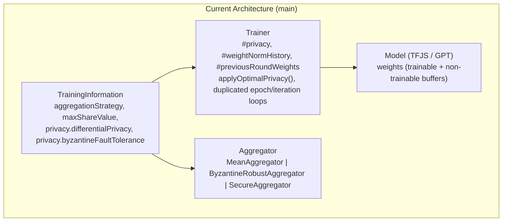
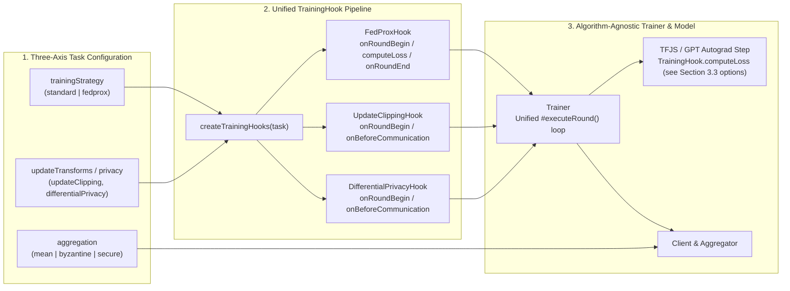
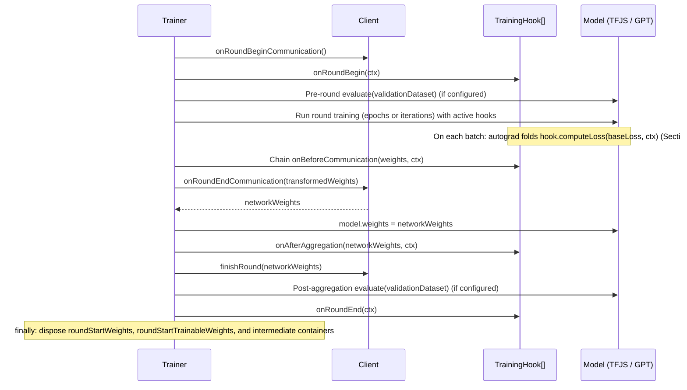

# Collaborative Training Architecture Design Document

## 1. Overview & Motivation

Disco supports collaborative machine learning across local, federated, and decentralized topologies. As the framework grows beyond standard Federated Averaging (FedAvg) to support richer optimization, robustness, and privacy algorithms—such as **FedProx**, **Learning Rate Schedules**, **Differential Privacy (ALDP-FL)**, **Byzantine-robust aggregation (Centered Clipping)**, **Secure Aggregation (MPC)**, and future protocol-extended methods (**FedNova**, **SCAFFOLD**)—the current abstractions on `main` exhibit structural coupling that makes adding and composing algorithms difficult.

This design document analyzes the architectural limitations in `discojs` today and proposes a modular, hook-driven target architecture inspired by **Flower's `Strategy` / `Mod` architecture** and **PyTorch Lightning / Keras `Callback` lifecycles**:

- **Three orthogonal configuration axes:** separating _intra-round local training strategy_, _post-round client update transformations & privacy_, and _inter-client weight aggregation_.
- **A single general `TrainingHook` lifecycle:** allowing algorithms to hook into round boundaries (`onRoundBegin`, `onBeforeCommunication`, `onAfterAggregation`, `onRoundEnd`) and local training steps (`onEpochBegin`, `onBatchBegin`, `computeLoss` inside autograd, `onBatchEnd`, `onEpochEnd`) without adding algorithm-specific fields to `Trainer` or algorithm-specific methods to `Model`.

---

## 2. Problem Statement: Current Architectural Limitations (`main` Baseline)



### 2.1. Conflation of Three Orthogonal Algorithmic Axes

In collaborative and federated learning, a training algorithm decomposes along **three independent axes**:

1. **Intra-Round Local Training Strategy (Client Optimization):** How each client optimizes its local model over its local dataset during a round:
   - Standard Empirical Risk Minimization (FedAvg)
   - Proximal regularization towards the round's initial weights: $\min_w F_k(w) + \frac{\mu}{2}\|w - w^{(t)}\|^2$ (FedProx)
   - Round- or epoch-level learning rate schedules and warmups
2. **Post-Round Client Update Transformation & Privacy (Pre-Communication):** How a client transforms its local weight progress $\Delta w_i^{(t)} = w_i^{(t, K)} - w^{(t)}$ after completing local epochs/iterations and before transmitting weights to the server or peers:
   - Explicit global or per-layer update norm clipping
   - Adaptive layer-wise Frobenius norm clipping + Gaussian noise injection (ALDP-FL Differential Privacy)
3. **Inter-Client Weight Aggregation & Protocol (Server / Peer Combination):** How updates from multiple participants are combined across the network:
   - Unweighted arithmetic mean (`MeanAggregator`, via `weights/aggregation.ts` `avg`)
   - Iterative Centered Clipping with momentum (`ByzantineRobustAggregator`)
   - Multi-round additive secret sharing (`SecureAggregator`)

Currently on `main`, `TrainingInformation` (`discojs/src/task/training_information.ts`) scatters aggregator parameters across `aggregationStrategy`, root-level `maxShareValue`, and `privacy.byzantineFaultTolerance`, and has no axis for client-side local training strategies:

- Modeling a client-side optimizer like FedProx as an `aggregationStrategy` is a category error: it forces `getAggregator` to map `"fedprox"` to `MeanAggregator` and **makes it impossible to compose FedProx with `ByzantineRobustAggregator` or `SecureAggregator`**.
- Conversely, adding one-off methods or arguments to `Model` for each new algorithm (`context?: RoundContext`, `attachRegularizer`, `setLearningRate`, `setGoldfishLoss`) forces every `Model` subclass (`TFJS`, `GPT`) and `Trainer` to be modified whenever a new algorithm is introduced.

### 2.2. Responsibility Leak Between `ByzantineRobustAggregator` and `Trainer`

In `discojs/src/training/trainer.ts` and `discojs/src/privacy.ts`, `ByzantineRobustAggregator`'s configuration leaks directly into client-side execution inside `Trainer`:

1. **Coupled clipping responsibility:** `ByzantineRobustAggregator` (`discojs/src/aggregator/byzantine.ts`) performs Centered Clipping on the receiving server or peer—which is where Byzantine fault tolerance must be enforced, because malicious peers do not obey client-side clipping. While standalone client-side update clipping (without Differential Privacy) is a valid feature on its own, `Trainer` currently couples it to `byzantineFaultTolerance.clippingRadius` and executes it inside `applyOptimalPrivacy` whenever BFT is enabled, rather than exposing it as an independent client-side update transform.
2. **Mathematical norm mismatch:** `ByzantineRobustAggregator` clips by the **global Euclidean ($L_2$) norm** across all weight tensors:
   $$\text{norm}(\Delta w) = \sqrt{\sum_{l=1}^{L} \|\Delta w_l\|_F^2}$$
   Conversely, `Trainer` passes `Repeat(bftClippingRadius).take(numLayers)` into `privacy.clipNorm` (`discojs/src/privacy.ts`), which clips **each layer's Frobenius norm individually** to `bftClippingRadius`. (Notably, the doc comment in `discojs/src/privacy.ts:81` claims _"If `radius.length === 1`, interpret `radius[0]` as a global clipping radius (BFT)"_, but line 85 immediately throws `Error("Layers and radius length failed to match")` if `radius.length !== layers.length`.)
3. **Conflated `applyOptimalPrivacy` helper:** `applyOptimalPrivacy` in `discojs/src/training/trainer.ts` runs even when Differential Privacy is disabled, coupling ALDP-FL adaptive noise calibration with client update clipping.

### 2.3. Monolithic `Trainer` State and Duplicated Round Lifecycle

`Trainer` (`discojs/src/training/trainer.ts`) violates the Open-Closed Principle by accumulating private fields and lifecycle branches for each feature:

- `#privacy`, `#weightNormHistory`, and `#previousRoundWeights` live directly on `Trainer`.
- Every new client-side algorithm forces additional private fields, constructor checks, and round-boundary branches into `Trainer`.
- **Duplicated round loops:** `#runRoundsByEpoch` / `#runRoundByEpoch` and `#runRoundsByIteration` / `#runRoundByIteration` duplicate round-begin communication, `#previousRoundWeights` tensor cloning, pre-aggregation validation, and `#finishRoundCommunication` invocation.
- **Unsafe duck-typed model casts:** `Trainer` casts `this.model as unknown as IterationTrainableTextModel` (`discojs/src/training/trainer.ts`), and `Disco` (`discojs/src/training/disco.ts`) performs similar duck-typed casts for `setDebugLabel`, `setGoldfishLoss`, and `setLearningRate`.

### 2.4. `Model` Contract, Non-Trainable Buffers (`BatchNormalization`), and Autograd

The `Model<D>` abstraction (`discojs/src/models/model.ts`) and its implementations (`TFJS` in `discojs/src/models/tfjs.ts` and `GPT` in `discojs/src/models/implementations/gpt/gpt.ts`) have three critical design issues when supporting collaborative training algorithms:

1. **Passing algorithm options into `Model.train(..., options)` forces every model to re-implement training loops:**
   - Standard `TFJS` training delegates to `this.model.fit(xs, ys, { epochs: 1, verbose: 0 })`, which natively handles `{ training: true }` forward passes (`Dropout`, `BatchNormalization`), all 14 Keras loss functions, layer regularizers (`calculateLosses()`), and compiled metrics.
   - If local objectives (such as FedProx's proximal penalty) are passed as arguments to `model.train(..., context)`, `TFJS` is forced to bypass `this.model.fit` and maintain a separate manual training loop (`optimizer.minimize` + manual loss/metric lookup), while `GPTModel.fitDataset` must also be modified with custom parameters. Every new model × algorithm combination multiplies this maintenance burden.
2. **`Model.weights` mixes trainable parameters with non-trainable buffers:**
   - In TensorFlow.js (`tf.LayersModel`), `this.model.weights` includes both `trainableWeights` (kernels, biases) and `nonTrainableWeights` (such as `BatchNormalization`'s `moving_mean` and `moving_variance`).
   - **Impact on local regularizers:** Computing proximal penalties over `Model.weights` during `{ training: true }` forward passes includes `BatchNormalization` running-statistic drift in the scalar loss and wastes tensor ops on non-trainable buffers every batch.
   - **Impact on Differential Privacy & clipping:** `applyOptimalPrivacy` in `Trainer` currently clips and adds Gaussian noise to **all** of `this.model.weights`, including non-trainable `moving_variance` tensors—which can drive `moving_variance` negative and cause `BatchNormalization` to produce `NaN` during inference.
3. **Current Differential Privacy accounting gaps (`discojs/src/privacy.ts` & `trainer.ts`):**
   - `addOptimalNoise` noises each layer $l$ independently with noise scale calibrated to $r_l / \epsilon$, which by composition spends $L \cdot \epsilon$ across $L$ layers unless calibrated to the global $L_2$ sensitivity $\sqrt{\sum_{l=1}^L r_l^2}$.
   - Adaptive quantile clipping radii (`getClippingRadius`) are computed from un-noised historical update norms (`#weightNormHistory`).
   - Per-round budget allocation uses basic linear composition ($\epsilon / T, \delta / T$).

---

## 3. Proposed Target Architecture



### 3.1. Three-Axis Task Configuration Schema (`discojs/src/task/training_information.ts`)

We separate task configuration into three orthogonal, strictly validated (`z.strictObject`) axes with uniform structure:

1. **`aggregation` (`aggregationStrategy` + `aggregationParams`):** Inter-client weight aggregation on the server or peers (`"mean" | "byzantine" | "secure"`).
2. **`trainingStrategy`:** Intra-round local client optimization strategy (`"standard" | "fedprox"`), composable with any `aggregationStrategy`.
3. **`updateTransforms` & `privacy`:** Post-round client update transformations executed in a canonical mathematical order before communication (`updateClipping` $\rightarrow$ `differentialPrivacy`).

```ts
import { z } from "zod";

// ---------------------------------------------------------------------------
// Axis 1: Inter-Client Weight Aggregation (Server / Peer-to-Peer ONLY)
// ---------------------------------------------------------------------------
export const meanAggregationConfigSchema = z.strictObject({
  aggregationStrategy: z.literal("mean"),
  aggregationParams: z.undefined().optional(),
});

export const byzantineAggregationConfigSchema = z.strictObject({
  aggregationStrategy: z.literal("byzantine"),
  aggregationParams: z
    .strictObject({
      clippingRadius: z.number().positive().default(1.0),
      maxIterations: z.number().int().positive().default(1),
      beta: z.number().min(0).max(1).default(0.9),
    })
    .default({ clippingRadius: 1.0, maxIterations: 1, beta: 0.9 }),
});

export const secureAggregationConfigSchema = z.strictObject({
  aggregationStrategy: z.literal("secure"),
  aggregationParams: z
    .strictObject({
      maxShareValue: z.number().positive().int().default(100),
    })
    .default({ maxShareValue: 100 }),
});

export const federatedAggregationConfigSchema = z.discriminatedUnion(
  "aggregationStrategy",
  [meanAggregationConfigSchema, byzantineAggregationConfigSchema],
);

export const decentralizedAggregationConfigSchema = z.discriminatedUnion(
  "aggregationStrategy",
  [
    meanAggregationConfigSchema,
    byzantineAggregationConfigSchema,
    secureAggregationConfigSchema,
  ],
);

export type AggregationConfig = z.infer<
  typeof decentralizedAggregationConfigSchema
>;
export type AggregationStrategy = AggregationConfig["aggregationStrategy"];

// ---------------------------------------------------------------------------
// Axis 2: Intra-Round Local Training Strategy (Client Optimization)
// Composable with ANY AggregationConfig!
// ---------------------------------------------------------------------------
export const trainingStrategySchema = z
  .discriminatedUnion("strategy", [
    z.strictObject({
      strategy: z.literal("standard"),
    }),
    z.strictObject({
      strategy: z.literal("fedprox"),
      mu: z.number().positive().default(0.01),
    }),
  ])
  .default({ strategy: "standard" });

export type TrainingStrategyConfig = z.infer<typeof trainingStrategySchema>;

// ---------------------------------------------------------------------------
// Axis 3: Post-Round Client Update Transforms & Privacy
// ---------------------------------------------------------------------------
export const updateClippingSchema = z.strictObject({
  clippingRadius: z.number().positive(),
  scope: z.enum(["global", "per-layer"]).default("global"),
});

export const privacySchema = z.strictObject({
  differentialPrivacy: z
    .strictObject({
      clippingRadius: z.number().positive().default(1),
      epsilon: z.number().positive(),
      delta: z.number().gt(0).lt(1),
    })
    .optional(),
});
```

---

### 3.2. Unified `TrainingHook` Lifecycle (Flower `Strategy` + Keras/Lightning `Callback` Pattern)

Instead of adding algorithm-specific fields to `Trainer` or algorithm-specific methods (`attachRegularizer`, `adaptLearningRate`, etc.) to `Model`, **every client-side training algorithm is expressed as a `TrainingHook`**.

```ts
import type * as tf from "@tensorflow/tfjs";
import type { DataType } from "#types/index";
import type { WeightsContainer } from "#weights/index";
import type { BatchLogs, EpochLogs, Model } from "#models/index";

/**
 * Execution context passed to TrainingHooks across round, epoch, and batch steps.
 * Round-start weight snapshots are lazily cloned at most ONCE per round on first access
 * and disposed automatically by Trainer at the end of the round.
 */
export interface HookContext<D extends DataType = DataType> {
  readonly model: Model<D>;
  readonly round: number;
  readonly totalRounds?: number;
  readonly epoch?: number;
  readonly batch?: number;

  /** Lazily clones and memoizes `model.weights` at the start of the current round. */
  roundStartWeights(): WeightsContainer;

  /** Lazily clones and memoizes `model.trainableWeights` at the start of the current round. */
  roundStartTrainableWeights(): WeightsContainer;
}

/**
 * Unified lifecycle hook covering both round boundaries (orchestrated by Trainer)
 * and local optimization steps (orchestrated via the Model's optimizer).
 */
export interface TrainingHook<D extends DataType = DataType>
  extends Partial<Disposable> {
  // -------------------------------------------------------------------------
  // 1. Round Lifecycle (Invoked by Trainer)
  // -------------------------------------------------------------------------
  onRoundBegin?(ctx: HookContext<D>): Promise<void> | void;

  /**
   * Transforms outgoing model weights after local training completes and
   * before `client.onRoundEndCommunication()` sends them to the server/peers.
   *
   * Ownership rule: A hook MUST NOT dispose its input `weights` container.
   * It returns either a newly allocated `WeightsContainer` or `weights` unchanged.
   * Trainer automatically disposes all intermediate containers in a `finally` block.
   */
  onBeforeCommunication?(
    weights: WeightsContainer,
    ctx: HookContext<D>,
  ): Promise<WeightsContainer> | WeightsContainer;

  /**
   * Invoked after `client.onRoundEndCommunication()` returns the aggregated weights
   * and `model.weights` has been updated.
   */
  onAfterAggregation?(
    aggregatedWeights: WeightsContainer,
    ctx: HookContext<D>,
  ): Promise<void> | void;

  onRoundEnd?(ctx: HookContext<D>): Promise<void> | void;

  // -------------------------------------------------------------------------
  // 2. Intra-Round Local Training Lifecycle (Invoked during Model.train)
  // -------------------------------------------------------------------------
  onEpochBegin?(ctx: HookContext<D>): Promise<void> | void;
  onEpochEnd?(logs: EpochLogs, ctx: HookContext<D>): Promise<void> | void;

  onBatchBegin?(ctx: HookContext<D>): Promise<void> | void;
  onBatchEnd?(logs: BatchLogs, ctx: HookContext<D>): Promise<void> | void;

  /**
   * Invoked inside TensorFlow.js's autograd scope (`optimizer.computeGradients`)
   * on every training step. Any differentiable penalty added to `baseLoss` is
   * automatically differentiated with respect to the model's trainable variables.
   */
  computeLoss?(baseLoss: tf.Scalar, ctx: HookContext<D>): tf.Scalar;
}
```

#### Why `TrainingHook` Solves Both `Trainer` and `Model` Bloat:

1. **`Model` and `Trainer` never gain algorithm-specific methods:**
   - **FedProx (`FedProxHook`):**
     - `onRoundBegin(ctx)`: calls `ctx.roundStartTrainableWeights()` to ensure the round-start snapshot is captured before the first gradient step.
     - `computeLoss(baseLoss, ctx)`: computes `proximalLoss = getProximalPenalty(ctx.model.trainableWeights, ctx.roundStartTrainableWeights(), this.#mu)` and returns `baseLoss.add(proximalLoss).asScalar()`.
   - **Learning Rate Schedule (`LearningRateScheduleHook`):**
     - `onRoundBegin(ctx)` or `onEpochBegin(ctx)`: updates learning rate as a function of `ctx.round` / `ctx.epoch`.
   - **Client Update Clipping (`UpdateClippingHook`):**
     - `onRoundBegin(ctx)`: calls `ctx.roundStartWeights()`.
     - `onBeforeCommunication(weights, ctx)`: clips $\Delta w = \text{weights} - \text{ctx.roundStartWeights()}$ by global $L_2$ or per-layer Frobenius norm.
   - **Differential Privacy (`DifferentialPrivacyHook`):**
     - Privately encapsulates `#weightNormHistory`.
     - `onRoundBegin(ctx)`: calls `ctx.roundStartWeights()`.
     - `onBeforeCommunication(weights, ctx)`: computes update norms, clips trainable updates, adds calibrated Gaussian noise, and returns the noisy weights.
2. **Shared Memoized Round-Start Snapshots (Memory Efficiency):**
   - If both `FedProxHook` and `DifferentialPrivacyHook` are active in the same round, `roundStartWeights()` and `roundStartTrainableWeights()` are allocated lazily at most once per round (crucial for large models like GPT where a full weight clone is $\ge 0.5\text{ GB}$) and disposed in `Trainer`'s `finally` block.
3. **Canonical Hook Ordering:**
   - `createTrainingHooks(task.trainingInformation)` constructs hooks in a deterministic canonical order:
     $$\text{FedProxHook} \rightarrow \text{UpdateClippingHook} \rightarrow \text{DifferentialPrivacyHook}$$
   - When both `updateClipping` and `differentialPrivacy` are configured, `DifferentialPrivacyHook` calibrates noise to $\min(\text{updateClipping.clippingRadius}, \text{dpClippingRadius})$.
4. **WebWorker Compatibility:**
   - Because workers receive serialized `Task` JSON and instantiate `Disco` and `Trainer` inside the worker thread, `createTrainingHooks(task.trainingInformation)` runs entirely inside the worker—no closures or hook instances ever cross `postMessage`.

---

### 3.3. Executing `TrainingHook.computeLoss` via Autograd: Design Options

A key requirement of this architecture is:

> **The user/task defines the model architecture (`tf.LayersModel` or `GPT`), base loss, and optimizer. When a collaborative training algorithm adds a differentiable loss regularizer (such as FedProx), Disco must fold it into the loss and differentiate it via TensorFlow.js autograd—without hardcoding algorithm-specific logic into `Model` or `Trainer`.**

Note that unlike Python Keras, TensorFlow.js (`@tensorflow/tfjs-layers` 4.22) does **not** support model-level `model.addLoss(fn)` during `model.fit()`: `Container.prototype.calculateLosses()` only collects losses from child layers (`// TODO(cais): Add any unconditional model-level losses?`).

Below are the **three candidate mechanisms** for wiring `TrainingHook.computeLoss` (and future gradient hooks) into `TFJS` and `GPT`, so we can align on the right robustness vs. generality trade-off:

| Option | Mechanism | `TFJS` keeps `model.fit()`? | Modifies TFJS runtime API? | Supports gradient hooks (SCAFFOLD, DP-SGD)? |
| :--- | :--- | :---: | :---: | :---: |
| **Option 1** | `TFJS` wraps the compiled loss via public `model.compile({ loss })`; `GPTModel` calls `hooks.computeLoss` directly in its existing `computeGradients` loop. | **Yes** | **No** | Loss hooks only (requires a separate path if a gradient hook is active) |
| **Option 2** | Both `TFJS` and `GPT` share one ~40-line `runTFJSStep` helper using `optimizer.computeGradients` $\rightarrow$ `transformGradients` $\rightarrow$ `applyGradients`. | **No** | **No** | **Yes** (uniformly for `TFJS` and `GPT`) |
| **Option 3** | Temporarily wrap `optimizer.computeGradients` on the `tf.Optimizer` instance for the duration of a round. | **Yes** | **Yes** | **Yes** (uniformly for `TFJS` and `GPT`) |

---

#### Option 1: Public `model.compile({ loss })` in `TFJS` + Direct Call in `GPTModel`

- **How it works:**
  - When no hook implements `computeLoss` (standard FedAvg, local training, Byzantine, DP), `TFJS` calls `this.model.fit(xs, ys, { epochs: 1, verbose: 0 })` completely untouched.
  - When one or more hooks implement `computeLoss`, `TFJS` wraps the model's existing loss function using TFJS's public `model.compile(...)` API while passing the existing `this.model.optimizer` instance (in `@tensorflow/tfjs-layers`, passing a `tf.Optimizer` instance assigns `this.optimizer_ = args.optimizer` directly, preserving Adam moments and iteration count):
    ```ts
    this.model.compile({
      optimizer: this.model.optimizer,
      loss: (yTrue: tf.Tensor, yPred: tf.Tensor) => {
        let totalLoss = baseLoss(yTrue, yPred).asScalar();
        for (const hook of lossHooks) {
          totalLoss = hook.computeLoss(totalLoss, getContext());
        }
        return totalLoss;
      },
      metrics: this.model.metrics,
    });
    ```
  - `GPTModel` (`discojs/src/models/implementations/gpt/model.ts`) already executes its own explicit `optimizer.computeGradients(...)` loop, so it invokes `hook.computeLoss(totalLoss, ctx)` directly inside that closure with no `compile` re-wrapping.
- **Pros:**
  - Keeps `this.model.fit(xs, ys)` in the loop for `TFJS`, preserving TFJS's built-in handling of `{ training: true }`, `calculateLosses()`, compiled metrics, and tensor disposal.
  - Uses only public TFJS APIs (no runtime method patching).
- **Cons:**
  - Handles different cases differently (`TFJS` vs. `GPT`, and loss hooks vs. future gradient hooks), adding branching complexity.
  - Only covers **loss-level** hooks inside `model.fit()`; supporting raw **gradient** hooks (`transformGradients`, e.g., SCAFFOLD or DP-SGD) on `TFJS` would still require a separate fallback step or migrating to Option 2.

---

#### Option 2: Shared Explicit TFJS Training Step (`runTFJSStep`) for Both `TFJS` and `GPT`

- **How it works:**
  - Because both `TFJS` and `GPT` wrap a `tf.LayersModel`, extract a single ~40-line helper that runs the autograd step directly for both models:
    ```ts
    const { value: loss, grads } = optimizer.computeGradients(() => {
      const preds = tfModel.apply(xs, { training: true }) as tf.Tensor;
      let totalLoss = computeDataLoss(ys, preds).asScalar();
      for (const reg of tfModel.calculateLosses()) {
        totalLoss = totalLoss.add(reg).asScalar();
      }
      for (const hook of lossHooks) {
        totalLoss = hook.computeLoss(totalLoss, ctx);
      }
      return totalLoss;
    }, trainableVars);

    let finalGrads = grads;
    for (const hook of gradHooks) {
      finalGrads = hook.transformGradients(finalGrads, ctx);
    }
    optimizer.applyGradients(finalGrads);
    ```
  - `TFJS` supplies its compiled loss + accuracy metric; `GPT` supplies next-token cross-entropy (+ optional Goldfish masking), its `AdamW` optimizer, and a global-norm clipping hook—allowing the `GPTModel.fitDataset` override and 1-batch-dataset indirection to be removed.
- **Pros:**
  - Uses only public TFJS APIs (no runtime method patching).
  - Handles training generically and uniformly across `TFJS` and `GPT` for both loss and gradient hooks (FedProx, SCAFFOLD, DP-SGD, gradient clipping).
  - Reduces duplicated training-loop code by unifying `TFJS` and `GPTModel.fitDataset` around one step primitive.
- **Cons:**
  - **Robustness trade-off for `TFJS`:** replacing `model.fit()` means Disco explicitly owns `{ training: true }` (Dropout/BatchNorm), `model.calculateLosses()` (layer L1/L2 regularizers), compiled loss lookup, and batch metric calculation, which may be less battle-tested on exotic custom Keras models than `model.fit()`.

---

#### Option 3: Scoped Runtime Wrapping of `optimizer.computeGradients`

- **How it works:**
  - Temporarily reassign `layersModel.optimizer.computeGradients = ...` for the duration of a round via a `Disposable` scope, intercepting both `TFJS.model.fit()` (via `optimizer.minimize` $\rightarrow$ `computeGradients`) and `GPTModel.fitDataset()`.
- **Pros:**
  - Keeps `model.fit()` untouched for `TFJS` while handling both `TFJS` and `GPT` (and both loss and gradient hooks) uniformly in one place.
- **Cons:**
  - **API- and internals-dependent:** mutates a method on a `@tensorflow/tfjs-core` `tf.Optimizer` instance at runtime and relies on TFJS's internal call chain (`Sequential` vs. functional `LayersModel` optimizer forwarding, `minimize` $\rightarrow$ `computeGradients`).

#### Critical TensorFlow.js Invariants (Relevant Across Options)

1. **Multi-Client Process Isolation (`varList`):**
   When calling `optimizer.computeGradients(f, varList)` directly (in `GPTModel` or Option 2), always pass `layersModel.trainableWeights.map(w => w.read() as tf.Variable)` rather than leaving `varList` undefined (which causes `tf.variableGrads` to sweep every registered `tf.Variable` in the global TFJS engine, including other clients' models in CLI simulations).
2. **Interaction with `AdamW` and Gradient Clipping in `GPTModel`:**
   In `discojs/src/models/implementations/gpt/optimizers.ts`, `AdamW` overrides `applyGradients` for decoupled weight decay, and `GPTModel` clips the global gradient norm between `computeGradients` and `applyGradients`. Adding `hooks.computeLoss` inside `computeGradients` guarantees that regularized gradients flow properly through global norm clipping and `AdamW`.
3. **Trainable-Only Regularization:**
   Hooks such as `FedProxHook` must compute penalties over `model.trainableWeights` (excluding non-trainable `BatchNormalization` moving statistics) so running-stat drift is never penalized.

---

### 3.4. Unified Round Execution in `Trainer`

`Trainer` (`discojs/src/training/trainer.ts`) becomes an algorithm-agnostic orchestrator with a single `#executeRound` method shared by both epoch-based and iteration-based training:



---

## 4. Scope Boundaries: Client-Only Hooks vs. Protocol Extensions & Non-Goals

To keep the architecture honest and avoid over-promising what a client-only hook can do, we categorize algorithms into three tiers:

| Tier                                                                           | Algorithms                                                                                                                                                                       | Architectural Requirements                                                                                                                                                                                                                            |
| :----------------------------------------------------------------------------- | :------------------------------------------------------------------------------------------------------------------------------------------------------------------------------- | :---------------------------------------------------------------------------------------------------------------------------------------------------------------------------------------------------------------------------------------------------- |
| **Tier 1: Client-Only `TrainingHook`s (In Scope)**                             | **FedProx**, **Client Update Clipping**, **ALDP-FL Differential Privacy**, **Learning Rate Schedules**                                                                           | Require only local round/batch lifecycle hooks (`onRoundBegin`, `computeLoss`, `onBeforeCommunication`, `onAfterAggregation`, `onRoundEnd`) and zero wire-protocol changes.                                                                           |
| **Tier 2: Protocol-Extended Hooks (Future Protocol Work)**                     | **Sample-Weighted FedAvg** ($n_i$), **FedNova** (step count $\tau_i$ for server $\tau_{\text{eff}}$ rescaling), **SCAFFOLD** (control variate delta $\Delta c_i$ and global $c$) | Cannot be implemented by weight-only client hooks alone. Require extending the `Client` / `Aggregator` wire payload with typed metadata (`RoundPayload { weights, metadata }`) and defining how `SecureAggregator` handles auxiliary scalars/vectors. |
| **Tier 3: Multi-Model / Activation Algorithms (Non-Goals for `TrainingHook`)** | **Ditto** (personalized secondary model), **MOON** (intermediate representation contrastive loss)                                                                                | Require maintaining a second personalized `Model` instance or extracting intermediate layer activations; outside the scope of `TrainingHook`.                                                                                                         |

---

## 5. Phased Implementation Plan

1. **Phase 1 — `TrainingHook` Pipeline & Autograd Loss Hook (`discojs`):**
   - Align on Section 3.3 (**Option 1** vs. **Option 2** vs. **Option 3**).
   - Introduce `TrainingHook` and `HookContext` in `discojs/src/training/`.
   - Extract `DifferentialPrivacyHook`, `UpdateClippingHook`, and `FedProxHook` out of `Trainer`.
   - Unify `Trainer`'s `#runRoundsByEpoch` and `#runRoundsByIteration` around a single `#executeRound` lifecycle method.
   - Expose `Model.trainableWeights` across `Model`, `TFJS`, and `GPT`.
2. **Phase 2 — Decouple `trainingStrategy` from `aggregationStrategy` (`discojs`, `server`, `cli`, `webapp`):**
   - Add `trainingStrategy: trainingStrategySchema` to `TrainingInformation` so `fedprox` is configured independently of `aggregationStrategy` (`mean`, `byzantine`, `secure`).
   - Add a backward-compatibility `z.preprocess` migration layer for persisted task JSON and update the CLI and webapp task creation form.
3. **Phase 3 — Decouple Client Update Clipping from `ByzantineRobustAggregator` & Fix DP Buffer Noise:**
   - Move optional client-side update clipping to `updateClippingSchema` so `byzantine.aggregationParams.clippingRadius` configures `ByzantineRobustAggregator` Centered Clipping exclusively.
   - Restrict Differential Privacy noise injection and update clipping to trainable parameters (or expose `weightSpecs(): { name: string; trainable: boolean }[]`) so non-trainable `BatchNormalization` running variances are never corrupted by Gaussian noise.
4. **Verification & Test Plan:**
   - Golden equivalence tests verifying that `FedProxHook` produces identical weight updates and losses to analytical proximal SGD across `tf.Sequential`, functional `tf.LayersModel`, `BatchNormalization` + `Dropout` models, and `GPT`.
   - Composition tests running `FedProxHook` + `ByzantineRobustAggregator`, `FedProxHook` + `SecureAggregator`, and `FedProxHook` + `DifferentialPrivacyHook`.
   - Strict tensor leak assertions (`tf.memory().numTensors`) across normal round completion, mid-round error, and `stopTraining()`.
