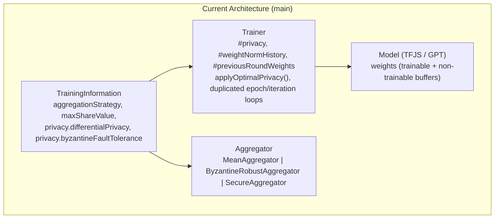
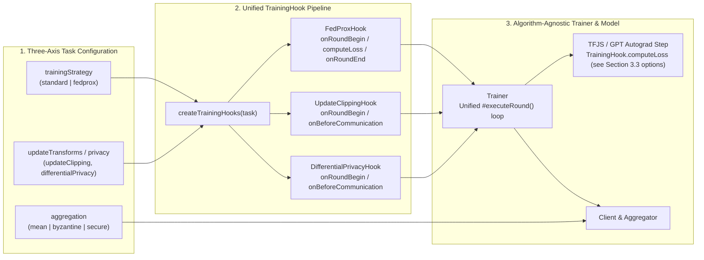
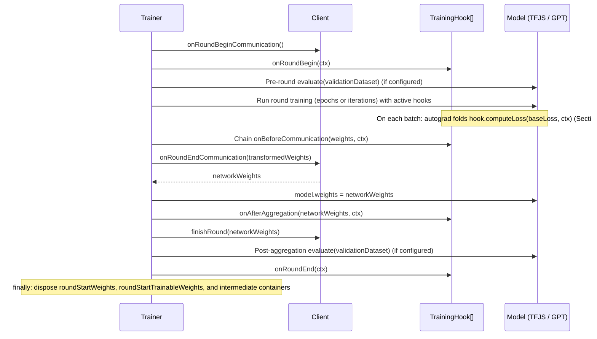

# Collaborative Training Architecture Design Document

## 1. Overview & Motivation

Disco supports collaborative machine learning across local, federated, and decentralized topologies. As the framework grows beyond standard Federated Averaging (FedAvg) to support richer optimization, robustness, and privacy algorithms—such as **FedProx**, **Learning Rate Schedules**, **Differential Privacy (ALDP-FL)**, **Byzantine-robust aggregation (Centered Clipping)**, **Secure Aggregation (MPC)**, and future protocol-extended methods (**FedNova**, **SCAFFOLD**)—the current abstractions on `main` exhibit structural coupling that makes adding and composing algorithms difficult.

This design document analyzes the architectural limitations in `discojs` today and proposes a modular, hook-driven target architecture inspired by **Flower's `Strategy` / `Mod` architecture** and **PyTorch Lightning / Keras `Callback` lifecycles**:

- **Three orthogonal configuration axes:** separating _intra-round local training strategy_, _post-round client update transformations & privacy_, and _inter-client weight aggregation_.
- **A single general `TrainingHook` lifecycle:** allowing algorithms to hook into round boundaries (`onRoundBegin`, `onBeforeCommunication`, `onAfterAggregation`, `onRoundEnd`) and local training steps (`onEpochBegin`, `onBatchBegin`, `computeLoss` inside autograd, `onBatchEnd`, `onEpochEnd`) without adding algorithm-specific fields to `Trainer` or algorithm-specific methods to `Model`.

---

## 2. Current Architectural Limitations



### 2.1. Conflation of Three Orthogonal Algorithmic Axes

In collaborative and federated learning, a training algorithm decomposes along **three independent axes**:

1. **Intra-Round Local Training Strategy (Client Optimization):** How each client optimizes its local model over its local dataset during a round:
   - Standard Empirical Risk Minimization (FedAvg)
   - Proximal regularization towards the round's initial weights: $\min_w F_k(w) + \frac{\mu}{2}\|w - w^{(t)}\|^2$ (FedProx)
   - Round- or epoch-level learning rate schedules and warmups
2. **Post-Round Client Update Transformation & Privacy (Pre-Communication):** How a client transforms its local weight progress $\Delta w_i^{(t)} = w_i^{(t, K)} - w^{(t)}$ after completing local epochs/iterations and before transmitting weights to the server or peers:
   - Explicit global or per-layer update norm clipping
   - Adaptive layer-wise Frobenius norm clipping + Gaussian noise injection (ALDP-FL Differential Privacy)
3. **Inter-Client Weight Aggregation & Protocol (Server / Peer Combination):** How updates from multiple participants are combined across the network:
   - Unweighted arithmetic mean (`MeanAggregator`, via `weights/aggregation.ts` `avg`)
   - Iterative Centered Clipping with momentum (`ByzantineRobustAggregator`)
   - Multi-round additive secret sharing (`SecureAggregator`)

Currently on `main`, `TrainingInformation` (`discojs/src/task/training_information.ts`) scatters aggregator parameters across `aggregationStrategy`, root-level `maxShareValue`, and `privacy.byzantineFaultTolerance`, and has no axis for client-side local training strategies:

- Modeling a client-side optimizer like FedProx as an `aggregationStrategy` is a category error: it forces `getAggregator` to map `"fedprox"` to `MeanAggregator` and **makes it impossible to compose FedProx with `ByzantineRobustAggregator` or `SecureAggregator`**.
- Conversely, the approach taken in [PR #1290](https://github.com/epfml/disco/pull/1290) is also not scalable: adding one-off methods or arguments to `Model` for each new algorithm (`context?: RoundContext`, `attachRegularizer`, `setLearningRate`, `setGoldfishLoss`) forces every `Model` subclass (`TFJS`, `GPT`) and `Trainer` to be modified whenever a new algorithm is introduced.

### 2.2. Monolithic `Trainer` State, Coupled Responsibilities, and Duplicated Round Lifecycle

`Trainer` violates the Open-Closed principle by accumulating feature-specific state and lifecycle branches directly on the class. This means that **implementing a new algorithm needs changing the trainer code**. Specific examples of smells are:

- **Algorithm state on `Trainer`:** `#privacy`, `#weightNormHistory`, and `#previousRoundWeights` live directly on `Trainer`, so each new client-side algorithm requires adding new private fields, constructor checks, and round-boundary branches.
- **Coupled BFT and client-side clipping:** `ByzantineRobustAggregator` must enforce clipping on the receiving server or peer (malicious peers do not obey client-side clipping). While standalone client-side update clipping is valid on its own, `Trainer` currently couples it to `byzantineFaultTolerance.clippingRadius` and routes it through `applyOptimalPrivacy` even when Differential Privacy is disabled, rather than exposing it as an independent client-side update transform (see also [#1300](https://github.com/epfml/disco/issues/1300) for the related client vs. aggregator norm mismatch).
- **Duplicated round loops:** `#runRoundsByEpoch` / `#runRoundByEpoch` and `#runRoundsByIteration` / `#runRoundByIteration` duplicate round-begin communication, `#previousRoundWeights` tensor cloning, pre-aggregation validation, and `#finishRoundCommunication`.
- **Duck-typed model casts:** `Trainer` casts `this.model` to `IterationTrainableTextModel`, and `Disco` (`discojs/src/training/disco.ts`) performs similar casts for `GPT`-only setters (`setDebugLabel`, `setGoldfishLoss`, `setLearningRate`).

### 2.3. Rigid `Model` Contract and Non-Trainable Buffers

- **No general hook boundary during local training:** Passing algorithm-specific options into `Model.train()` forces every `Model` subclass (`TFJS`, `GPT`) to maintain custom training-loop branches for each new algorithm instead of keeping standard training paths intact.
- **Trainable weights mixed with non-trainable buffers:** `Model.weights` includes both trainable parameters and non-trainable buffers (such as `BatchNormalization` moving statistics), so local regularizers and client-side privacy transforms cannot target trainable parameters cleanly (see also [#1301](https://github.com/epfml/disco/issues/1301) for related Differential Privacy bugs).

---

## 3. Proposed Target Architecture



### 3.1. Three-Axis Task Configuration Schema (`discojs/src/task/training_information.ts`)

We separate task configuration into three orthogonal, strictly validated (`z.strictObject`) axes with uniform structure:

1. **`aggregation` (`{ strategy, params }`):** Inter-client weight aggregation on the server or peers (`"mean" | "byzantine" | "secure"`).
2. **`trainingStrategy` (`{ strategy, params }`):** Intra-round local client optimization strategy (`"standard" | "fedprox"`), composable with any `aggregation.strategy`.
3. **`updateTransforms` & `privacy`:** Post-round client update transformations executed in a canonical mathematical order before communication (`updateClipping` $\rightarrow$ `differentialPrivacy`).

<details>
<summary>Axis 1: <code>aggregation</code></summary>

```ts
// One of:
{ strategy: "mean" }
{ strategy: "byzantine", params: { clippingRadius: ..., maxIterations: ..., beta: ... } }
{ strategy: "secure", params: { maxShareValue: ... } }
```

</details>

<details>
<summary>Axis 2: <code>trainingStrategy</code></summary>

```ts
// One of:
{ strategy: "standard" }
{ strategy: "fedprox", params: { mu: ... } }
```

</details>

<details>
<summary>Axis 3: <code>updateTransforms</code> &amp; <code>privacy</code></summary>

```ts
updateClipping?: { clippingRadius: ..., scope: "global" | "per-layer" }

privacy?: {
  differentialPrivacy?: { clippingRadius: ..., epsilon: ..., delta: ... }
}
```

</details>

---

### 3.2. Unified `TrainingHook` Lifecycle

Instead of adding algorithm-specific fields to `Trainer` or algorithm-specific methods (`attachRegularizer`, `adaptLearningRate`, etc.) to `Model`, **every client-side training algorithm is expressed as a `TrainingHook`**. This is similar to other frameworks suchas **Flower's `Strategy`** and \*\*PyTorch Lightning / Keras `Callback`.

```ts
interface HookContext<D extends DataType = DataType> {
  readonly model: Model<D>;
  readonly round: number;
  readonly totalRounds?: number;
  readonly epoch?: number;
  readonly batch?: number;
  roundStartWeights(): WeightsContainer;
  roundStartTrainableWeights(): WeightsContainer;
}

interface TrainingHook<D extends DataType = DataType>
  extends Partial<Disposable> {
  onRoundBegin?(ctx: HookContext<D>): Promise<void> | void;
  onBeforeCommunication?(
    weights: WeightsContainer,
    ctx: HookContext<D>,
  ): Promise<WeightsContainer> | WeightsContainer;
  onAfterAggregation?(
    aggregatedWeights: WeightsContainer,
    ctx: HookContext<D>,
  ): Promise<void> | void;
  onRoundEnd?(ctx: HookContext<D>): Promise<void> | void;

  onEpochBegin?(ctx: HookContext<D>): Promise<void> | void;
  onEpochEnd?(logs: EpochLogs, ctx: HookContext<D>): Promise<void> | void;
  onBatchBegin?(ctx: HookContext<D>): Promise<void> | void;
  onBatchEnd?(logs: BatchLogs, ctx: HookContext<D>): Promise<void> | void;
  computeLoss?(baseLoss: tf.Scalar, ctx: HookContext<D>): tf.Scalar;
}
```

#### Why `TrainingHook` Solves Both `Trainer` and `Model` Bloat:

1. **`Model` and `Trainer` never gain algorithm-specific methods:**
   - **FedProx (`FedProxHook`):**
     - `onRoundBegin(ctx)`: calls `ctx.roundStartTrainableWeights()` to ensure the round-start snapshot is captured before the first gradient step.
     - `computeLoss(baseLoss, ctx)`: computes `proximalLoss = getProximalPenalty(ctx.model.trainableWeights, ctx.roundStartTrainableWeights(), this.#mu)` and returns `baseLoss.add(proximalLoss).asScalar()`.
   - **Learning Rate Schedule (`LearningRateScheduleHook`):**
     - `onRoundBegin(ctx)` or `onEpochBegin(ctx)`: updates learning rate as a function of `ctx.round` / `ctx.epoch`.
   - **Client Update Clipping (`UpdateClippingHook`):**
     - `onRoundBegin(ctx)`: calls `ctx.roundStartWeights()`.
     - `onBeforeCommunication(weights, ctx)`: clips $\Delta w = \text{weights} - \text{ctx.roundStartWeights()}$ by global $L_2$ or per-layer Frobenius norm.
   - **Differential Privacy (`DifferentialPrivacyHook`):**
     - Privately encapsulates `#weightNormHistory`.
     - `onRoundBegin(ctx)`: calls `ctx.roundStartWeights()`.
     - `onBeforeCommunication(weights, ctx)`: computes update norms, clips trainable updates, adds calibrated Gaussian noise, and returns the noisy weights.
2. **Shared Memoized Round-Start Snapshots (Memory Efficiency):**
   - If both `FedProxHook` and `DifferentialPrivacyHook` are active in the same round, `roundStartWeights()` and `roundStartTrainableWeights()` are allocated lazily at most once per round (crucial for large models like GPT where a full weight clone is $\ge 0.5\text{ GB}$) and disposed in `Trainer`'s `finally` block.
3. **Canonical Hook Ordering:**
   - `createTrainingHooks(task.trainingInformation)` constructs hooks in a deterministic canonical order:
     $$\text{FedProxHook} \rightarrow \text{UpdateClippingHook} \rightarrow \text{DifferentialPrivacyHook}$$
   - When both `updateClipping` and `differentialPrivacy` are configured, `DifferentialPrivacyHook` calibrates noise to $\min(\text{updateClipping.clippingRadius}, \text{dpClippingRadius})$.
4. **WebWorker Compatibility:**
   - Because workers receive serialized `Task` JSON and instantiate `Disco` and `Trainer` inside the worker thread, `createTrainingHooks(task.trainingInformation)` runs entirely inside the worker—no closures or hook instances ever cross `postMessage`.

---

### 3.3. Executing `TrainingHook.computeLoss` via Autograd: Design Options

A key requirement of this architecture is:

> **The user/task defines the model architecture (`tf.LayersModel` or `GPT`), base loss, and optimizer. When a collaborative training algorithm adds a differentiable loss regularizer (such as FedProx), Disco must fold it into the loss and differentiate it via TensorFlow.js autograd—without hardcoding algorithm-specific logic into `Model` or `Trainer`.**

Note that unlike Python Keras, TensorFlow.js (`@tensorflow/tfjs-layers` 4.22) does **not** support model-level `model.addLoss(fn)` during `model.fit()`: `Container.prototype.calculateLosses()` only collects losses from child layers (`// TODO(cais): Add any unconditional model-level losses?`).

Below are the **three candidate mechanisms** for wiring `TrainingHook.computeLoss` (and future gradient hooks) into `TFJS` and `GPT`, so we can align on the right robustness vs. generality trade-off:

| Option       | Mechanism                                                                                                                                                           | `TFJS` keeps `model.fit()`? | Modifies TFJS runtime API? |               Supports gradient hooks (SCAFFOLD, DP-SGD)?               |
| :----------- | :------------------------------------------------------------------------------------------------------------------------------------------------------------------ | :-------------------------: | :------------------------: | :---------------------------------------------------------------------: |
| **Option 1** | `TFJS` wraps the compiled loss via public `model.compile({ loss })`; `GPTModel` calls `hooks.computeLoss` directly in its existing `computeGradients` loop.         |           **Yes**           |           **No**           | Loss hooks only (requires a separate path if a gradient hook is active) |
| **Option 2** | Both `TFJS` and `GPT` share one ~40-line `runTFJSStep` helper using `optimizer.computeGradients` $\rightarrow$ `transformGradients` $\rightarrow$ `applyGradients`. |           **No**            |           **No**           |                **Yes** (uniformly for `TFJS` and `GPT`)                 |
| **Option 3** | Temporarily wrap `optimizer.computeGradients` on the `tf.Optimizer` instance for the duration of a round.                                                           |           **Yes**           |          **Yes**           |                **Yes** (uniformly for `TFJS` and `GPT`)                 |

---

#### Option 1: Public `model.compile({ loss })` in `TFJS` + Direct Call in `GPTModel`

- **How it works:**
  - When no hook implements `computeLoss` (standard FedAvg, local training, Byzantine, DP), `TFJS` calls `this.model.fit(xs, ys, { epochs: 1, verbose: 0 })` completely untouched.
  - When one or more hooks implement `computeLoss`, `TFJS` wraps the model's existing loss function using TFJS's public `model.compile(...)` API while passing the existing `this.model.optimizer` instance (in `@tensorflow/tfjs-layers`, passing a `tf.Optimizer` instance assigns `this.optimizer_ = args.optimizer` directly, preserving Adam moments and iteration count):
    ```ts
    this.model.compile({
      optimizer: this.model.optimizer,
      loss: (yTrue: tf.Tensor, yPred: tf.Tensor) => {
        let totalLoss = baseLoss(yTrue, yPred).asScalar();
        for (const hook of lossHooks) {
          totalLoss = hook.computeLoss(totalLoss, getContext());
        }
        return totalLoss;
      },
      metrics: this.model.metrics,
    });
    ```
  - `GPTModel` (`discojs/src/models/implementations/gpt/model.ts`) already executes its own explicit `optimizer.computeGradients(...)` loop, so it invokes `hook.computeLoss(totalLoss, ctx)` directly inside that closure with no `compile` re-wrapping.
- **Pros:**
  - Keeps `this.model.fit(xs, ys)` in the loop for `TFJS`, preserving TFJS's built-in handling of `{ training: true }`, `calculateLosses()`, compiled metrics, and tensor disposal.
  - Uses only public TFJS APIs (no runtime method patching).
- **Cons:**
  - Handles different cases differently (`TFJS` vs. `GPT`, and loss hooks vs. future gradient hooks), adding branching complexity.
  - Only covers **loss-level** hooks inside `model.fit()`; supporting raw **gradient** hooks (`transformGradients`, e.g., SCAFFOLD or DP-SGD) on `TFJS` would still require a separate fallback step or migrating to Option 2.

---

#### Option 2: Shared Explicit TFJS Training Step (`runTFJSStep`) for Both `TFJS` and `GPT`

- **How it works:**
  - Because both `TFJS` and `GPT` wrap a `tf.LayersModel`, extract a single ~40-line helper that runs the autograd step directly for both models:

    ```ts
    const { value: loss, grads } = optimizer.computeGradients(() => {
      const preds = tfModel.apply(xs, { training: true }) as tf.Tensor;
      let totalLoss = computeDataLoss(ys, preds).asScalar();
      for (const reg of tfModel.calculateLosses()) {
        totalLoss = totalLoss.add(reg).asScalar();
      }
      for (const hook of lossHooks) {
        totalLoss = hook.computeLoss(totalLoss, ctx);
      }
      return totalLoss;
    }, trainableVars);

    let finalGrads = grads;
    for (const hook of gradHooks) {
      finalGrads = hook.transformGradients(finalGrads, ctx);
    }
    optimizer.applyGradients(finalGrads);
    ```

  - `TFJS` supplies its compiled loss + accuracy metric; `GPT` supplies next-token cross-entropy (+ optional Goldfish masking), its `AdamW` optimizer, and a global-norm clipping hook—allowing the `GPTModel.fitDataset` override and 1-batch-dataset indirection to be removed.

- **Pros:**
  - Uses only public TFJS APIs (no runtime method patching).
  - Handles training generically and uniformly across `TFJS` and `GPT` for both loss and gradient hooks (FedProx, SCAFFOLD, DP-SGD, gradient clipping).
  - Reduces duplicated training-loop code by unifying `TFJS` and `GPTModel.fitDataset` around one step primitive.
- **Cons:**
  - **Robustness trade-off for `TFJS`:** replacing `model.fit()` means Disco explicitly owns `{ training: true }` (Dropout/BatchNorm), `model.calculateLosses()` (layer L1/L2 regularizers), compiled loss lookup, and batch metric calculation, which may be less battle-tested on exotic custom Keras models than `model.fit()`.

---

#### Option 3: Scoped Runtime Wrapping of `optimizer.computeGradients`

- **How it works:**
  - Temporarily reassign `layersModel.optimizer.computeGradients = ...` for the duration of a round via a `Disposable` scope, intercepting both `TFJS.model.fit()` (via `optimizer.minimize` $\rightarrow$ `computeGradients`) and `GPTModel.fitDataset()`.
- **Pros:**
  - Keeps `model.fit()` untouched for `TFJS` while handling both `TFJS` and `GPT` (and both loss and gradient hooks) uniformly in one place.
- **Cons:**
  - **API- and internals-dependent:** mutates a method on a `@tensorflow/tfjs-core` `tf.Optimizer` instance at runtime and relies on TFJS's internal call chain (`Sequential` vs. functional `LayersModel` optimizer forwarding, `minimize` $\rightarrow$ `computeGradients`).

#### Critical TensorFlow.js Invariants (Relevant Across Options)

1. **Multi-Client Process Isolation (`varList`):**
   When calling `optimizer.computeGradients(f, varList)` directly (in `GPTModel` or Option 2), always pass `layersModel.trainableWeights.map(w => w.read() as tf.Variable)` rather than leaving `varList` undefined (which causes `tf.variableGrads` to sweep every registered `tf.Variable` in the global TFJS engine, including other clients' models in CLI simulations).
2. **Interaction with `AdamW` and Gradient Clipping in `GPTModel`:**
   In `discojs/src/models/implementations/gpt/optimizers.ts`, `AdamW` overrides `applyGradients` for decoupled weight decay, and `GPTModel` clips the global gradient norm between `computeGradients` and `applyGradients`. Adding `hooks.computeLoss` inside `computeGradients` guarantees that regularized gradients flow properly through global norm clipping and `AdamW`.
3. **Trainable-Only Regularization:**
   Hooks such as `FedProxHook` must compute penalties over `model.trainableWeights` (excluding non-trainable `BatchNormalization` moving statistics) so running-stat drift is never penalized.

---

### 3.4. Unified Round Execution in `Trainer`

`Trainer` (`discojs/src/training/trainer.ts`) becomes an algorithm-agnostic orchestrator with a single `#executeRound` method shared by both epoch-based and iteration-based training:



---

## 4. Future Extensions

The `TrainingHook` pipeline above covers all **client-only** algorithms that require no wire-protocol changes (such as **FedProx**, **Client Update Clipping**, **ALDP-FL Differential Privacy**, and **Learning Rate Schedules**).

Some collaborative algorithms also require exchanging auxiliary metadata alongside model weights between clients and the server/peers—for example:

- **Sample-Weighted FedAvg:** Clients send their local sample count $n_i$ so the aggregator computes $\sum_i \frac{n_i}{\sum_j n_j} w_i$ instead of an unweighted average.
- **FedNova:** Clients send their local step count $\tau_i$ alongside their normalized update so the server can rescale the aggregated update by $\tau_{\text{eff}} = \sum_i p_i \tau_i$.
- **SCAFFOLD:** Clients and the server exchange control variates in both directions (downlink global $c$ and uplink $\Delta c_i$) alongside model weights.

The three-axis decomposition and `TrainingHook` lifecycle do not need to be redesigned to support these algorithms—they can be accommodated later by extending the communication boundary:

1. **Typed round envelope (`RoundPayload`):** Extend `Client` and `Aggregator` to exchange `{ weights: WeightsContainer; metadata?: Record<string, number | WeightsContainer> }` in both directions instead of a bare `WeightsContainer` (and define whether auxiliary scalars/vectors are secret-shared or sent separately under `SecureAggregator`).
2. **Metadata-aware hook boundaries:** Pass `RoundPayload` through `onBeforeCommunication(payload, ctx)` (so hooks can attach uplink metadata such as $n_i$, $\tau_i$, or $\Delta c_i$) and `onAfterAggregation(payload, ctx)` (so hooks can read downlink metadata such as updated global $c$).
3. **Metadata-aware aggregation:** Allow `Aggregator` implementations (or server-side hooks) to combine `payload.metadata` alongside `payload.weights`.
