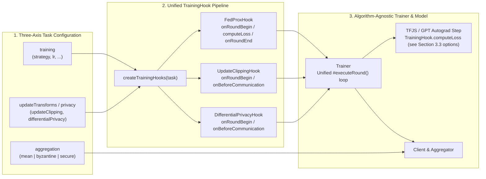
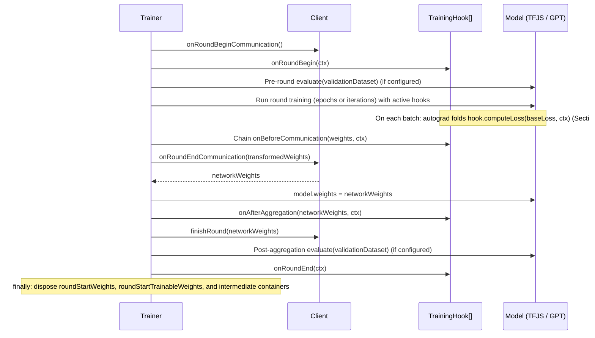

# Collaborative Training Architecture Design Document

## 1. Overview & Motivation

Disco supports collaborative machine learning across local, federated, and decentralized topologies. As the framework grows beyond standard Federated Averaging (FedAvg) to support richer optimization, robustness, and privacy algorithms—such as **FedProx**, **Learning Rate Schedules**, **Differential Privacy (ALDP-FL)**, **Byzantine-robust aggregation (Centered Clipping)**, **Secure Aggregation (MPC)**, and future protocol-extended methods (**FedNova**, **SCAFFOLD**)—the current abstractions on `main` exhibit structural coupling that makes adding and composing algorithms difficult.

This design document analyzes the architectural limitations in `discojs` today and proposes a modular, hook-driven target architecture inspired by **Flower's `Strategy` / `Mod` architecture** and **PyTorch Lightning / Keras `Callback` lifecycles**:

- **Three orthogonal configuration axes:** separating _intra-round local training strategy_, _post-round client update transformations & privacy_, and _inter-client weight aggregation_.
- **A single general `TrainingHook` lifecycle:** allowing algorithms to hook into round boundaries (`onRoundBegin`, `onBeforeCommunication`, `onAfterAggregation`, `onRoundEnd`) and local training steps (`onEpochBegin`, `onBatchBegin`, `computeLoss` inside autograd, `onBatchEnd`, `onEpochEnd`) without adding algorithm-specific fields to `Trainer` or algorithm-specific methods to `Model`.

---

## 2. Current Architectural Limitations

### 2.1. Conflation of Three Orthogonal Algorithmic Axes

In collaborative and federated learning, a training algorithm decomposes along **three independent axes**:

1. **Intra-Round Local Training Strategy (Client Optimization):** How each client optimizes its local model over its local dataset during a round:
   - Standard Empirical Risk Minimization (FedAvg)
   - Proximal regularization towards the round's initial weights: $\min_w F_k(w) + \frac{\mu}{2}\|w - w^{(t)}\|^2$ (FedProx)
   - Round- or epoch-level learning rate schedules and warmups
2. **Post-Round Client Update Transformation & Privacy (Pre-Communication):** How a client transforms its local weight progress $\Delta w_i^{(t)} = w_i^{(t, K)} - w^{(t)}$ after completing local epochs/iterations and before transmitting weights to the server or peers:
   - Explicit global or per-layer update norm clipping
   - Adaptive layer-wise Frobenius norm clipping + Gaussian noise injection (ALDP-FL Differential Privacy)
3. **Inter-Client Weight Aggregation & Protocol (Server / Peer Combination):** How updates from multiple participants are combined across the network (e.g mean, byzantine, ...)

Currently, the `TrainingInformation` object of the task scatters algorithm parameters across `aggregationStrategy`, root-level `maxShareValue`, and `privacy.byzantineFaultTolerance`. [PR #1290](https://github.com/epfml/disco/pull/1290) is a first step in correcting this as it reserves a place for the parameters of the different aggregators, so for example, `byzantineFaultTolerance` becomes a parameter of the byzantine aggregator rather than `privacy`. Yet even after those changes, a fundamental problem remains: Disco does not currently have configuration dedicated to local training—it assumes local training rounds happen via standard ERM. This causes problems such as the following:

- Modeling a client-side optimizer like FedProx ([PR #1289](https://github.com/epfml/disco/pull/1289)) as an `aggregationStrategy` is a category error: it forces `getAggregator` to map `"fedprox"` to `MeanAggregator` and **makes it impossible to compose FedProx with `ByzantineRobustAggregator` or `SecureAggregator`**.
- Local optimization settings that do exist (such as `learningRate` and `goldfishLoss`) live inside data-type schemas (e.g. `text`) instead of a dedicated local-training axis, while `Trainer` and `Model` lack a general hook boundary to consume them cleanly (detailed in Sections 2.2 and 2.3).
- Nesting `byzantineFaultTolerance` under `privacy` couples aggregation config to client-side privacy, leading `Trainer` to route client-side clipping through its privacy helper even when Differential Privacy is disabled. This really just shows how the independence of these three axis is violated currently.

### 2.2. Monolithic `Trainer` State, Coupled Responsibilities, and Duplicated Round Lifecycle

`Trainer` violates the Open-Closed principle by accumulating feature-specific state and lifecycle branches directly on the class. This means that **implementing a new algorithm needs changing the trainer code**. Specific examples of smells are:

- **Algorithm state on `Trainer`:** DP-related settings such as `#privacy` and `#weightNormHistory` live directly on `Trainer`, and are there even when DP is not used. This reflects the approach that has been taken so far to implement new algorithm setttings: each new client-side algorithm requires adding new private fields, constructor checks, and round-boundary branches.
- **Duplicated round loops:** `#runRoundsByEpoch` / `#runRoundByEpoch` and `#runRoundsByIteration` / `#runRoundByIteration` duplicate round-begin communication, `#previousRoundWeights` tensor cloning, pre-aggregation validation, and `#finishRoundCommunication`.

- **No general hook boundary during local training:** Passing algorithm-specific options into `Model.train()` forces every `Model` subclass (`TFJS`, `GPT`) to maintain custom training-loop branches for each new algorithm instead of keeping standard training paths intact.
- **Duck-typed model casts:** `Trainer` casts `this.model` to `IterationTrainableTextModel`, and `Disco` (`discojs/src/training/disco.ts`) performs similar casts for `GPT`-only setters (`setDebugLabel`, `setGoldfishLoss`, `setLearningRate`).

---

## 3. Proposed Target Architecture



### 3.1. Three-Axis Task Configuration Schema

We separate task configuration into three orthogonal axes with uniform structure:

1. **aggregation:** Inter-client weight aggregation on the server or peers. Examples could be _mean_ which is standard FedAvg or _median_ which is a byzantine robust aggregation. Current ones are mean, byzantine and secure.

2. **training:** Intra-round local client optimization strategies plus composable options like `lr`, `learningRateSchedule`, `goldfishLoss`, composable with any `aggregation.strategy`.
3. **communication transforms** Post-round client update transformations executed in a canonical mathematical order before communication such as _differential privacy_, or model compression.

**Pro**: This removes the problems mentioned in 2.1, it dedicates a place in the config for training-only options, without cluttering aggregation configs. So for example, `FedProx`, being only a training strategy, would be composable with byzantine aggregators. It also adds space for other pre-communication strategy different than privacy, such as compression, or client-side clipping and so on, without having to put them under a specific aggregator.

<details>
<summary>Axis 1: <code>aggregation</code></summary>

```ts
// One of:
{ strategy: "mean" }
{ strategy: "byzantine", params: { clippingRadius: ..., maxIterations: ..., beta: ... } }
{ strategy: "secure", params: { maxShareValue: ... } }

// We could have in the trainingInformation something like this
{
  ...,
  aggregation: {
    strategy: "mean",
    params: {...}
  }
}
```

</details>

<details>
<summary>Axis 2: <code>training</code></summary>

```ts
training?: {
  strategy?:
    | { name: "standard" }
    | { name: "fedprox", params: { mu: ... } },
  lr?: ...,
  learningRateSchedule?: ...,
  goldfishLoss?: ...,
  // ...other orthogonal intra-round options
}
```

</details>

<details>
<summary>Axis 3: <code>communication transforms</code> &amp; <code>privacy</code></summary>

```ts
// In training information
{
  precommunication: {
    privacy: {
      clippingRadius: ...,
      ...,
    },
    // Other possible feature
    compression: { ... }
  }
}
```

</details>

---

### 3.2. Unified `TrainingHook` Lifecycle

Even after having a dedicated place for training settings in the config, we still need to make `Trainer` scalable and independent of the specific strategies, so we don't have to change it every time we add a new strategy. Instead of adding algorithm-specific fields to `Trainer` or algorithm-specific methods (`attachRegularizer`, `adaptLearningRate`, etc.) to `Model`, **every client-side training algorithm is expressed as a TrainingHook**. This is similar to other frameworks suchas **Flower's `Strategy`** and \*\*PyTorch Lightning / Keras `Callback`.

An example of what a training hook could look like is the following:

```ts
interface HookContext<D extends DataType = DataType> {
  readonly model: Model<D>;
  readonly round: number;
  readonly totalRounds?: number;
  readonly epoch?: number;
  readonly batch?: number;
  roundStartWeights(): WeightsContainer;
  roundStartTrainableWeights(): WeightsContainer;
}

interface TrainingHook<D extends DataType = DataType>
  extends Partial<Disposable> {
  onRoundBegin?(ctx: HookContext<D>): Promise<void> | void;
  onBeforeCommunication?(
    weights: WeightsContainer,
    ctx: HookContext<D>,
  ): Promise<WeightsContainer> | WeightsContainer;
  onAfterAggregation?(
    aggregatedWeights: WeightsContainer,
    ctx: HookContext<D>,
  ): Promise<void> | void;
  onRoundEnd?(ctx: HookContext<D>): Promise<void> | void;

  onEpochBegin?(ctx: HookContext<D>): Promise<void> | void;
  onEpochEnd?(logs: EpochLogs, ctx: HookContext<D>): Promise<void> | void;
  onBatchBegin?(ctx: HookContext<D>): Promise<void> | void;
  onBatchEnd?(logs: BatchLogs, ctx: HookContext<D>): Promise<void> | void;
  computeLoss?(baseLoss: tf.Scalar, ctx: HookContext<D>): tf.Scalar;
}
```

#### How these hooks solve the current trainer and model bloat:

No algorithm-specific methods anymore. For example the following could be implemented like this:

- **FedProx -> FedProxHook:**: uses `onRoundBegin(ctx)` to get `ctx.roundStartTrainableWeights()` and in `computeLoss`, it adds the proximal loss to the base loss.
- **Adding a LR Schedule -> LearningRateScheduleHook:** can update the LR by attaching to `onRoundBegin(ctx)` or `onEpochBegin(ctx)` and can model learning rate as a function of `ctx.round` / `ctx.epoch`.
- **Differential Privacy -> DifferentialPrivacyHook:** Can privately encapsulates `#weightNormHistory` without it lying on the trainer, and can use `onBeforeCommunication(weights, ctx)` to compute update norms, clips trainable updates, adds calibrated Gaussian noise, and returns the noisy weights.

A possible _complexity_ however is ensuring the hooks are self-consistent with each other, and they're executed in a deterministic order. But this should just come down to making sure the config is valid.
How would this be combined with **WebWorkers**? Workers receive serialized `Task` JSON and instantiate `Disco` and `Trainer` inside the worker thread, so we can directly create the hooks in the workers with `createTrainingHooks(task.trainingInformation)`.

---

### 3.3. The model class

The **model** class only needs four capabilities—each directly addressing the coupling identified in Section 2:

1. **In-loop hook execution:** Drive `onEpochBegin` / `onEpochEnd` / `onBatchBegin` / `onBatchEnd`, compose `computeLoss` into the autograd loss before backpropagation, and (for gradient-level algorithms) apply `transformGradients` before the optimizer update. This removes algorithm-specific branches from `Model.train()`.
2. **Stateful hyperparameter updates:** Expose a way to update training hyperparameters (such as `setLearningRate`) in place without resetting optimizer state (e.g., Adam moments), eliminating duck-typed model-specific setters in `Disco`.
3. **Uniform round-training boundary:** Execute a round's local training uniformly across models whether bounded by epochs or iterations/batches, eliminating `IterationTrainableTextModel` casts in `Trainer`.
4. **Trainable parameters vs. non-trainable buffers:** Pretty straightforward but currently main does not expose trainable vs non-trainable so this has to be changed (see [issue #1301](https://github.com/epfml/disco/issues/1301)).We expose trainable parameters separately from full weights so regularizers (like FedProx) and privacy transforms only target learned parameters.

Due to limitations of TFJS, a question remains on how the Hook's `computeLoss` should be integrated in the model loss. A few opitons are discussed in [TFJS_TRAINING_HOOKS.md](./TFJS_TRAINING_HOOKS.md).

---

### 3.4. Proposed round execution

With this architecture, the trainer becomes an algorithm-agnostic orchestrator with a single `#executeRound` method shared by both epoch-based and iteration-based training:



---

## 4. Future Extensions

The `TrainingHook` pipeline above covers all **client-only** algorithms that require no wire-protocol changes (such as **FedProx**, **Client Update Clipping**, **ALDP-FL Differential Privacy**, and **Learning Rate Schedules**).

Some collaborative algorithms also require exchanging auxiliary metadata alongside model weights between clients and the server/peers—for example:

- **Sample-Weighted FedAvg:** Clients send their local sample count $n_i$ so the aggregator computes $\sum_i \frac{n_i}{\sum_j n_j} w_i$ instead of an unweighted average.
- **FedNova:** Clients send their local step count $\tau_i$ alongside their normalized update so the server can rescale the aggregated update by $\tau_{\text{eff}} = \sum_i p_i \tau_i$.
- **SCAFFOLD:** Clients and the server exchange control variates in both directions (downlink global $c$ and uplink $\Delta c_i$) alongside model weights.

The three-axis decomposition and `TrainingHook` lifecycle do not need to be redesigned to support these algorithms—they can be accommodated later by extending the communication boundary:

1. **Typed round envelope (`RoundPayload`):** Extend `Client` and `Aggregator` to exchange `{ weights: WeightsContainer; metadata?: Record<string, number | WeightsContainer> }` in both directions instead of a bare `WeightsContainer` (and define whether auxiliary scalars/vectors are secret-shared or sent separately under `SecureAggregator`).
2. **Metadata-aware hook boundaries:** Pass `RoundPayload` through `onBeforeCommunication(payload, ctx)` (so hooks can attach uplink metadata such as $n_i$, $\tau_i$, or $\Delta c_i$) and `onAfterAggregation(payload, ctx)` (so hooks can read downlink metadata such as updated global $c$).
3. **Metadata-aware aggregation:** Allow `Aggregator` implementations (or server-side hooks) to combine `payload.metadata` alongside `payload.weights`.
