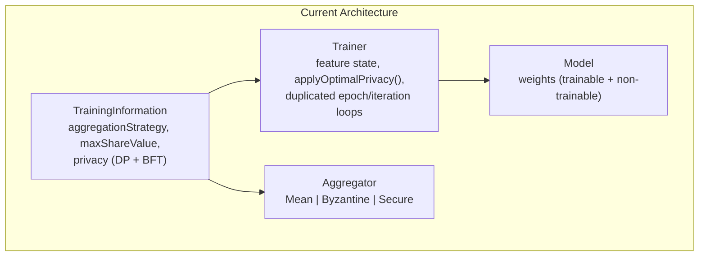
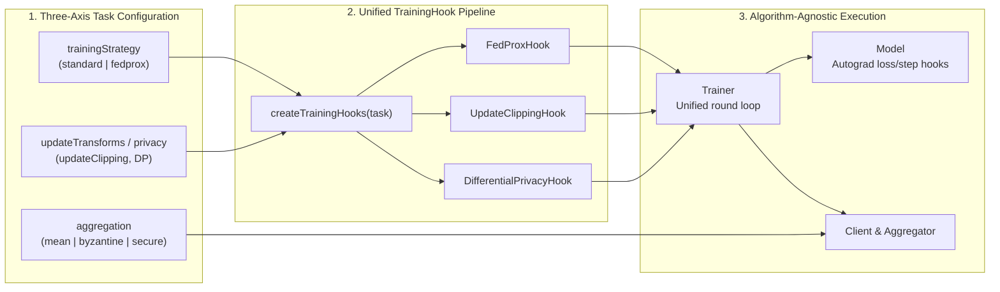
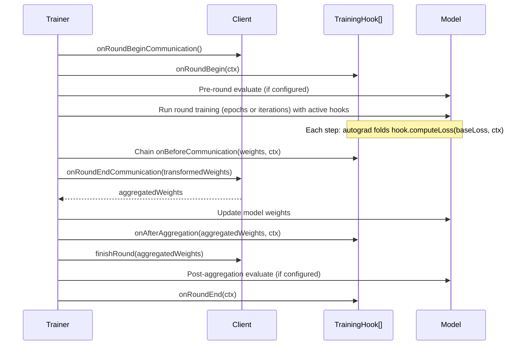

# Collaborative Training Architecture Design Document

## 1. Overview & Motivation

Disco supports collaborative machine learning across local, federated, and decentralized topologies. As the framework grows beyond standard Federated Averaging (FedAvg) to support richer optimization, robustness, and privacy algorithms—such as **FedProx**, **Learning Rate Schedules**, **Differential Privacy**, **Byzantine-robust aggregation**, and **Secure Aggregation**—the current abstractions exhibit structural coupling that makes adding and composing algorithms difficult.

This proposal outlines a modular, backend-agnostic target architecture built around two ideas:

- **Three orthogonal configuration axes:** separating _local training strategy_, _client update transformations & privacy_, and _inter-client weight aggregation_.
- **A unified `TrainingHook` lifecycle:** allowing algorithms to plug into round boundaries and local training steps without adding algorithm-specific state to `Trainer` or algorithm-specific methods to `Model`.

---

## 2. Current Architectural Limitations



As shown in the diagram above, configuration, round orchestration, and model execution are tightly coupled across three layers:

### 2.1. Conflation of Three Orthogonal Algorithmic Axes

In collaborative learning, a training algorithm decomposes along **three independent axes**:

1. **Intra-Round Local Training Strategy (Client Optimization):** How each client optimizes its local model during a round (e.g., standard ERM / FedAvg, FedProx proximal regularization toward round-start weights, or learning rate schedules).
2. **Post-Round Client Update Transformation & Privacy (Pre-Communication):** How a client transforms its local weight update after local training and before communicating it (e.g., update norm clipping, Differential Privacy noise injection).
3. **Inter-Client Weight Aggregation (Server / Peer Combination):** How updates from participants are combined across the network (e.g., arithmetic mean, Byzantine-robust Centered Clipping, or Secure Aggregation via MPC).

Currently, `TrainingInformation` scatters aggregator parameters across top-level fields and `privacy`, and has no axis for client-side local training strategies:

- Modeling a client-side optimizer like FedProx as an `aggregationStrategy` prevents composing FedProx with Byzantine-robust or Secure Aggregation.
- Conversely, the approach taken in [PR #1289](https://github.com/epfml/disco/pull/1289) is also not scalable: adding one-off methods or arguments to `Model` for each new algorithm (`RoundContext`, `setLearningRate`, `setGoldfishLoss`) forces every `Model` implementation and `Trainer` to be modified whenever a new algorithm is introduced.

### 2.2. Monolithic `Trainer` State, Coupled Responsibilities, and Duplicated Round Lifecycle

`Trainer` violates the Open-Closed principle by accumulating feature-specific state and lifecycle branches directly on the class. This means that **implementing a new algorithm needs changing the trainer code**. Specific examples of smells are:

- **Algorithm state on `Trainer`:** Privacy config, update norm history, and previous-round weight snapshots live directly on `Trainer`, so each new client-side algorithm adds new fields, constructor checks, and round-boundary branches.
- **Coupled BFT and client-side clipping:** Byzantine-robust aggregation must enforce clipping on the receiving server or peer (malicious peers do not obey client-side clipping). While standalone client-side update clipping is valid on its own, `Trainer` currently couples it to the BFT clipping radius and runs it through the Differential Privacy helper even when DP is disabled, rather than exposing it as an independent client-side update transform (see [#1300](https://github.com/epfml/disco/issues/1300)).
- **Duplicated round loops:** Epoch-based and iteration-based training duplicate round-begin communication, round-start weight snapshots, validation, and round-end communication.
- **Model-specific casts:** `Trainer` and `Disco` rely on duck-typed casts to reach model-specific methods (such as iteration-based training or text-model setters).

### 2.3. Rigid `Model` Contract and Non-Trainable Buffers

- **No general hook boundary during local training:** Passing algorithm-specific options into `Model.train()` forces every `Model` implementation to maintain custom training-loop branches for each new algorithm.
- **Trainable weights mixed with non-trainable buffers:** `Model.weights` exposes both trainable parameters and non-trainable buffers (such as `BatchNormalization` running statistics), so local regularizers and client-side privacy transforms cannot cleanly target trainable parameters alone (see [#1301](https://github.com/epfml/disco/issues/1301)).

---

## 3. Proposed Target Architecture



As illustrated above, task configuration splits cleanly into three axes (**1**): client-side axes (`trainingStrategy` and `updateTransforms / privacy`) are instantiated into a `TrainingHook` pipeline (**2**) consumed by an algorithm-agnostic `Trainer` and `Model` (**3**), while `aggregation` configures `Client & Aggregator` independently.

### 3.1. Three-Axis Task Configuration

Task configuration is separated into three orthogonal axes, with `aggregation` and `trainingStrategy` sharing a uniform `{ strategy, params }` discriminated-union shape:

1. **`aggregation`:** Inter-client weight aggregation on the server or peers (`mean`, `byzantine`, `secure`).
2. **`trainingStrategy`:** Intra-round local client optimization (`standard`, `fedprox`), composable with any `aggregation` strategy.
3. **`updateTransforms` & `privacy`:** Post-round client update transformations executed in a canonical order before communication (`updateClipping`, then `differentialPrivacy`).

<details>
<summary>Axis 1: <code>aggregation</code> shape</summary>

```ts
// One of:
{ strategy: "mean" }
{ strategy: "byzantine", params: { clippingRadius: ..., maxIterations: ..., beta: ... } }
{ strategy: "secure", params: { maxShareValue: ... } }
```

</details>

<details>
<summary>Axis 2: <code>trainingStrategy</code> shape</summary>

```ts
// One of:
{ strategy: "standard" }
{ strategy: "fedprox", params: { mu: ... } }
```

</details>

<details>
<summary>Axis 3: <code>updateTransforms</code> &amp; <code>privacy</code> shape</summary>

```ts
updateClipping?: { clippingRadius: ..., scope: "global" | "per-layer" }
privacy?: {
  differentialPrivacy?: { clippingRadius: ..., epsilon: ..., delta: ... }
}
```

</details>

---

### 3.2. Unified `TrainingHook` Lifecycle

Instead of adding algorithm-specific fields to `Trainer` or algorithm-specific methods (`attachRegularizer`, `adaptLearningRate`, etc.) to `Model`, **every client-side training algorithm is expressed as a `TrainingHook`**. This is similar to other frameworks such as **Flower's `Strategy`** and **PyTorch Lightning / Keras `Callback`**.

A hook can tap into two levels of the lifecycle:

- **Round lifecycle (orchestrated by `Trainer`):** `onRoundBegin`, `onBeforeCommunication` (transforms outgoing weights), `onAfterAggregation`, and `onRoundEnd`.
- **Local training lifecycle (orchestrated during `Model.train`):** `onEpochBegin` / `onEpochEnd`, `onBatchBegin` / `onBatchEnd`, and `computeLoss` (adds differentiable regularization terms inside the backend's autograd step).

<details>
<summary>Minimal <code>HookContext</code> and <code>TrainingHook</code> interface</summary>

```ts
interface HookContext<D> {
  readonly model: Model<D>;
  readonly round: number;
  readonly totalRounds?: number;
  readonly epoch?: number;
  readonly batch?: number;
  roundStartWeights(): WeightsContainer;
  roundStartTrainableWeights(): WeightsContainer;
}

interface TrainingHook<D> {
  onRoundBegin?(ctx: HookContext<D>): Promise<void> | void;
  onBeforeCommunication?(
    weights: WeightsContainer,
    ctx: HookContext<D>,
  ): Promise<WeightsContainer> | WeightsContainer;
  onAfterAggregation?(
    aggregatedWeights: WeightsContainer,
    ctx: HookContext<D>,
  ): Promise<void> | void;
  onRoundEnd?(ctx: HookContext<D>): Promise<void> | void;

  onEpochBegin?(ctx: HookContext<D>): Promise<void> | void;
  onEpochEnd?(logs: EpochLogs, ctx: HookContext<D>): Promise<void> | void;
  onBatchBegin?(ctx: HookContext<D>): Promise<void> | void;
  onBatchEnd?(logs: BatchLogs, ctx: HookContext<D>): Promise<void> | void;
  computeLoss?(baseLoss: Scalar, ctx: HookContext<D>): Scalar;
}
```

</details>

How existing and planned client-side algorithms map onto `TrainingHook`:

- **FedProx:** Captures `roundStartTrainableWeights()` on `onRoundBegin` and adds the proximal penalty in `computeLoss`.
- **Learning Rate Schedule:** Updates the learning rate in `onRoundBegin` or `onEpochBegin` as a function of the global round or epoch.
- **Client Update Clipping:** Clips the local weight update relative to `roundStartWeights()` in `onBeforeCommunication`.
- **Differential Privacy:** Encapsulates its own norm history, clips trainable updates, and adds calibrated Gaussian noise in `onBeforeCommunication`.

Key architectural properties of this design:

- **Shared lazy snapshots:** Round-start weight snapshots are cloned lazily at most once per round and shared across all active hooks (important for large models like LLMs).
- **Canonical ordering:** Hooks are constructed from task config in a deterministic order (`FedProx` $\rightarrow$ `UpdateClipping` $\rightarrow$ `DifferentialPrivacy`).
- **WebWorker-friendly:** Hooks are constructed from serialized task config inside the worker; no closures or hook instances cross worker boundaries.

---

### 3.3. Backend-Agnostic `Model` Boundary

To keep this architecture independent of any specific ML backend (e.g., TensorFlow.js today, Burn or others in the future), `Model` only needs two general capabilities:

1. **Distinguish trainable parameters from non-trainable buffers:** Expose trainable parameters alongside full weights so regularizers and privacy mechanisms never penalize or noise non-trainable buffers (like `BatchNormalization` running statistics).
2. **Evaluate `TrainingHook.computeLoss` inside autograd:** When a client-side algorithm adds a differentiable loss term (such as FedProx), the model backend folds `hook.computeLoss(baseLoss, ctx)` into its loss computation before backpropagation so gradients flow automatically through the model's configured optimizer.

<details>
<summary>Backend implementation note: TensorFlow.js integration options (for discussion)</summary>

In TensorFlow.js (`@tensorflow/tfjs-layers`), model-level `model.addLoss()` is not evaluated during `model.fit()`, so there are three ways to wire `TrainingHook.computeLoss` (and future gradient hooks) into `TFJS` and `GPT`:

| Option       | Mechanism                                                                                                                                                                        | `TFJS` keeps `model.fit()`? | Modifies TFJS runtime API? |        Supports gradient hooks (SCAFFOLD, DP-SGD)?         |
| :----------- | :------------------------------------------------------------------------------------------------------------------------------------------------------------------------------- | :-------------------------: | :------------------------: | :--------------------------------------------------------: |
| **Option 1** | `TFJS` wraps the compiled loss via public `model.compile({ loss })` (preserving the existing optimizer); `GPT` calls `hooks.computeLoss` directly in its existing gradient loop. |           **Yes**           |           **No**           | Loss hooks only (needs a separate path for gradient hooks) |
| **Option 2** | Both `TFJS` and `GPT` share one explicit training step (`computeGradients` $\rightarrow$ `transformGradients` $\rightarrow$ `applyGradients`).                                   |           **No**            |           **No**           |          **Yes** (uniformly for `TFJS` and `GPT`)          |
| **Option 3** | Temporarily wrap `optimizer.computeGradients` on the optimizer instance for the duration of a round.                                                                             |           **Yes**           |          **Yes**           |          **Yes** (uniformly for `TFJS` and `GPT`)          |

Trade-offs:

- **Option 1** keeps `model.fit()` and uses only public APIs, but handles `TFJS` vs. `GPT` (and loss vs. future gradient hooks) differently.
- **Option 2** handles training generically and uniformly across `TFJS` and `GPT`, but replaces `model.fit()` in `TFJS` (which may be less robust on exotic custom Keras models).
- **Option 3** keeps `model.fit()` and handles both models uniformly, but depends on TFJS runtime internals.

</details>

---

### 3.4. Unified Round Execution in `Trainer`

`Trainer` becomes an algorithm-agnostic orchestrator with a single round execution flow shared by both epoch-based and iteration-based training. As shown in the sequence diagram below, `Trainer` drives communication and delegates all algorithm-specific behavior to the `TrainingHook` pipeline:



---

## 4. Expected Limitations & Future Extensions

The `TrainingHook` pipeline covers all **client-only** algorithms that require no wire-protocol changes (such as **FedProx**, **Client Update Clipping**, **Differential Privacy**, and **Learning Rate Schedules**).

However, algorithms that require exchanging auxiliary metadata alongside model weights between clients and the server/peers cannot be implemented by weight-only client hooks alone—for example:

- **Sample-Weighted FedAvg:** Clients must send their local sample count so the aggregator can compute a weighted average instead of an unweighted mean.
- **FedNova:** Clients must send their local step count alongside their normalized update so the server can rescale the aggregated update.
- **SCAFFOLD:** Clients and the server must exchange control variates in both directions alongside model weights.

The three-axis decomposition and `TrainingHook` lifecycle do not need to be redesigned to support these algorithms—they can be accommodated later by extending the communication boundary:

1. **Typed round envelope:** Extend `Client` and `Aggregator` to exchange a structured payload (`weights` plus optional `metadata`) in both directions instead of bare weights (and define how `SecureAggregator` handles auxiliary metadata).
2. **Metadata-aware hook boundaries:** Pass the payload through `onBeforeCommunication` (to attach uplink metadata) and `onAfterAggregation` (to read downlink metadata).
3. **Metadata-aware aggregation:** Allow `Aggregator` implementations (or server-side hooks) to combine metadata alongside weights.
